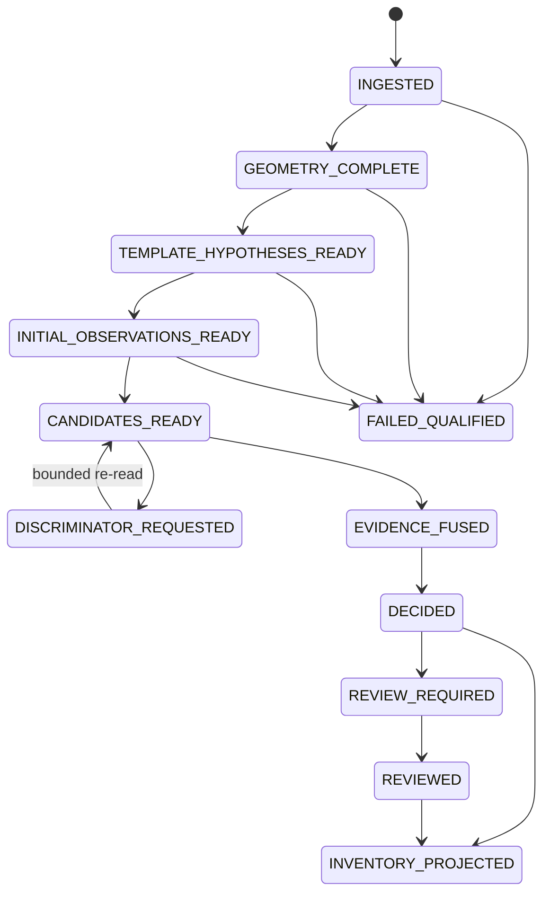

# Robust Detection and Identification Application Architecture

Status: **Target architecture candidate — not implemented**

Authority: Commissioner-requested CIO architecture definition

Baseline: repository commit `906b204` plus the commissioned sample evidence

Architecture style: local-first, evidence-led modular monolith with replaceable
extractor and corpus adapters

## 1. Executive decision

The application must be designed as an evidence system, not as an OCR script.
Its primary unit of work is a version-bound `AnalysisRun` that transforms an
immutable capture into observations, competing hypotheses, candidate
assessments, and a qualified decision. The system must retain every material
intermediate object required to reproduce, challenge, supersede, or improve the
decision.

The current vertical slice is a useful laboratory prototype. It is not the
architecture described here. In particular, its two-choice template predictor
and three-zone runtime extraction are insufficient to support the words
**robust and meticulous**.

### CIO decision

No future document or release may describe the detector as robust or meticulous
until the measurable gates in section 18 pass on a versioned benchmark. The
architecture is admitted as a construction baseline, not as evidence that its
components exist or work.

### SSAC disposition

- trigger: `EVIDENCE_CHANGE` and `PLAN_OR_STRATEGY_SELECTION`;
- disposition: `ADMIT_QUALIFIED`;
- observed: the sample exposed a material gap between declared template zones
  and runtime zone analysis, and between template selection and general template
  classification;
- inference: template ontology, zone localization, extractors, corpus fields,
  and evaluation data must co-evolve through explicit contracts;
- safe next action: construct the bounded architecture in dependency order while
  preserving the existing run as historical counterevidence;
- unverified: template taxonomy coverage, zone detector accuracy, candidate
  recall, image confirmation, confidence calibration, and media rights.

## 2. Mandate and semantic boundaries

The business outcome is reproducible bulk inventory of photographed Pokémon TCG
cards with specific, inspectable evidence for category, layout family, semantic
zones, catalogue identity, language, set, number, and observable printing
variant. The application must prefer a qualified unknown over an invented fact.

The following identities are non-interchangeable:

- a source image is not a card identity;
- a template hypothesis is not a template fact;
- a zone definition is not a localized zone observation;
- an OCR string is not a parsed field and neither is a reference match;
- artwork similarity is not printing identity;
- a candidate ranking is not an identification decision;
- a human correction supersedes but does not erase machine evidence;
- a passing test is not release authorization.

## 3. Logical application topology

```mermaid
flowchart LR
  subgraph Control[Control and Governance Plane]
    CLI[CLI / Local API]
    ORCH[Run Orchestrator]
    REG[Version Registry]
    POLICY[Decision Policies]
  end

  subgraph Reference[Reference and Corpus Plane]
    LAND[Immutable Source Landing]
    ADAPT[Corpus Adapters]
    CANON[Canonical Reference Store]
    SEARCH[Structured / Text Indexes]
    MEDIA[Governed Media Manifest]
    FP[Reference Fingerprints]
  end

  subgraph Perception[Perception and Interpretation Plane]
    CAP[Capture Ingest]
    GEO[Page / Pocket / Card Geometry]
    DERIV[Normalized Derivatives]
    ANCHOR[Anchor and Marker Detection]
    TCLASS[Hierarchical Template Classifier]
    ZLOC[Zone Localization Engine]
    EXTRACT[Typed Extractor Ensemble]
    OBS[Observation Ledger]
  end

  subgraph Reasoning[Candidate and Decision Plane]
    RETRIEVE[Candidate Retrieval]
    DISCRIM[Information-Gain Planner]
    COMPARE[Typed Evidence Comparator]
    FUSE[Evidence Fusion]
    DECIDE[Abstaining Decision Engine]
  end

  subgraph Human[Review and Inventory Plane]
    REVIEW[Human Review Workbench]
    SUPER[Superseding Assertions]
    INVENTORY[Inventory Projection]
    EXPORT[JSONL / CSV / SQLite]
  end

  subgraph Assurance[Evaluation and Operations Plane]
    FIX[Ground-Truth Fixture Registry]
    BENCH[Benchmark Harness]
    CAL[Calibration / Threshold Registry]
    DRIFT[Regression and Drift Reports]
  end

  CLI --> ORCH
  ORCH --> CAP --> GEO --> DERIV --> ANCHOR --> TCLASS --> ZLOC --> EXTRACT --> OBS
  LAND --> ADAPT --> CANON --> SEARCH
  CANON --> MEDIA --> FP
  OBS --> RETRIEVE
  SEARCH --> RETRIEVE
  RETRIEVE --> DISCRIM --> ZLOC
  OBS --> COMPARE
  CANON --> COMPARE
  FP --> COMPARE
  COMPARE --> FUSE --> DECIDE
  DECIDE --> REVIEW --> SUPER --> INVENTORY --> EXPORT
  DECIDE --> INVENTORY
  REG --> ORCH
  POLICY --> DECIDE
  FIX --> BENCH --> CAL --> POLICY
  BENCH --> DRIFT
```

The topology is a **modular monolith** for the local single-user phase. Modules
communicate through versioned in-process ports and persisted contracts, not
network services. This is the least-complex deployable architecture that still
allows OCR providers, symbol models, image matchers, corpus sources, and review
surfaces to be replaced independently. Service decomposition is deferred until
measured concurrency or isolation needs justify it.

## 4. Physical deployment and stores

The initial application runs as one local Python process with optional worker
subprocesses for model isolation. It owns five storage boundaries:

1. **Immutable artifact store** — original captures, reference source snapshots,
   crops, masks, and derived images addressed by SHA-256.
2. **Canonical reference database** — SQLite tables for corpus snapshots,
   series, sets, card identities, printings, multilingual fields, mechanics,
   variants, and source mappings.
3. **Search database** — SQLite FTS5 plus structured indexes; an optional vector
   index is prohibited until conventional retrieval is benchmarked.
4. **Evidence database** — append-only run, observation, candidate, comparison,
   decision, review, and supersession records.
5. **Registry repository** — version-controlled templates, zone ontology,
   extractor profiles, model manifests, policies, fixtures, and calibration
   manifests.

Reference media is registered by manifest and rights status. Absence of a
permitted local image is a data state, not an invitation to fetch one silently.

## 5. Canonical contracts

Every persisted object has a stable ID, schema version, producer version,
creation time, provenance, and content hash where applicable.

### 5.1 Reference-side contracts

- `ReferenceCorpusSnapshot`
- `ReferenceSourceRecord`
- `ReferenceSeries`
- `ReferenceSet`
- `ReferenceCardIdentity`
- `ReferencePrinting`
- `ReferenceVariantAssertion`
- `ReferenceCardImage`
- `ReferenceImageFingerprint`
- `SourceFieldMappingDecision`
- `CorpusValidationFinding`

`ReferenceCardIdentity` represents the game identity. Language, edition,
finish, stamp, region, and other printing-specific properties belong to
`ReferencePrinting` or qualified variant assertions. This avoids pretending a
single upstream row always maps to one physical printing.

### 5.2 Observation-side contracts

- `Capture`
- `AnalysisRun`
- `PageObservation`
- `PocketObservation`
- `CardFaceObservation`
- `GeometryObservation`
- `QualityObservation`
- `AnchorObservation`
- `TemplateHypothesis`
- `LocalizedZoneObservation`
- `ExtractorAttempt`
- `TextObservation`
- `SymbolObservation`
- `NumericObservation`
- `VisualFeatureObservation`

An `ExtractorAttempt` records the exact source pixels, preprocessing recipe,
model and model-data versions, parameters, raw alternatives, confidences,
runtime warnings, and failure. A normalized value never replaces raw output.

### 5.3 Reasoning-side contracts

- `CandidateQueryPlan`
- `CandidateSet`
- `CandidateAssessment`
- `EvidenceComparison`
- `Contradiction`
- `MissingDiscriminator`
- `DiscriminatorPlan`
- `IdentificationDecision`
- `HumanReviewDisposition`
- `InventoryCardInstance`

Each comparison states observed value, expected value, method, strength,
reliability, applicability, independence family, contradiction status, and
supporting object IDs. Decision policy consumes comparison objects; it does not
read OCR output or database rows directly.

## 6. Corpus-ingestion architecture

The corpus plane is a staged, restartable ingestion pipeline:

`snapshot acquisition -> immutable landing -> structural validation -> source parsing -> canonical mapping -> quarantine -> cross-record validation -> index build -> optional media registration -> manifest seal`

### Required components

- `CorpusSourceAdapter` port with a TCGdex implementation;
- source-structure validator that fails closed on unexpected shapes;
- lossless raw-payload repository;
- explicit field-mapping registry with `mapped`, `preserved-only`, `derived`,
  `unsupported`, and `quarantined` dispositions;
- canonical normalizers for Unicode, collector numbers, languages, categories,
  mechanics, and variants;
- cross-source identity resolver that never collapses IDs by string alone;
- referential-integrity validator for series/set/card relationships;
- duplicate and collision detector;
- change detector between corpus generations;
- index builder with row counts and deterministic checksums;
- media manifest builder with rights, provenance, retrieval, hash, dimensions,
  and derivative-fingerprint status;
- signed/sealed ingestion manifest describing errors and omissions.

Imported fields such as abilities, attacks, energy costs, weaknesses,
resistances, retreat, stage, suffix, regulation, illustrator, variants, and
multilingual names must be queryable canonical data—not only preserved inside a
raw payload.

## 7. Hierarchical template classification architecture

Template classification is a staged inference problem, not one flat label. The
classifier returns a lattice of compatible hypotheses with calibrated scores and
reasons at each level:

1. **Product scope:** physical Pokémon TCG versus excluded/nonphysical scope.
2. **Face state:** front, back, empty pocket, occluded, partial, or unknown.
3. **Orientation:** portrait, landscape, rotated, split/multi-card layout.
4. **Card category:** Pokémon, Trainer, Energy, or unknown.
5. **Script/language/region:** independent observations, not one inferred field.
6. **Era/layout grammar:** Wizards/early, Neo, e-Card, EX, DP/Platinum, HGSS,
   BW/XY, SM, SWSH, SV, or an evidence-supported finer family.
7. **Mechanic/form:** owner-associated, Baby, e-Reader, ex/EX/GX/V/VMAX/VSTAR,
   LV.X, SP, LEGEND, BREAK, Radiant, Ancient/Future, ACE SPEC, and others.
8. **Language/region overlay:** geometry, labels, symbol systems, and footer
   conventions.
9. **Set/card exception:** only for demonstrated structural exceptions.
10. **Printing overlay:** edition, promotional/event stamp, foil/reverse pattern,
    border treatment, or unresolved.

### Classification inputs

- border and frame geometry;
- global band and box layout;
- art-window geometry;
- title/HP/classification anchor locations;
- card-category headings and grammar;
- script distribution;
- energy, rarity, set, regulation, and mechanic symbols;
- logos and owner portraits;
- footer topology;
- OCR only from semantically weak preliminary regions;
- candidate feedback, clearly labeled as posterior evidence.

### Classification method

Use a coarse-to-fine ensemble:

- deterministic geometry and color features;
- anchor/symbol detectors;
- script classifier;
- optional learned layout classifier after labeled coverage exists;
- constraint solver that rejects incompatible combinations;
- top-k calibrated ranking with an `unknown-family` escape;
- ensemble disagreement and out-of-distribution indicators.

No classifier may assume the exact template it is meant to prove merely to
obtain its input crop. Preliminary crops must use family-neutral anchors or
multiple competing maps.

## 8. Template registry architecture

Each versioned `CardTemplateFamily` contains:

- identity, parent, lifecycle state, provenance, fixtures, and semantic version;
- applicability predicates and explicit negative predicates;
- supported category, era, language/region, mechanic, and orientation;
- global anchors and expected spatial relationships;
- normalized zone definitions and candidate-dependent alternatives;
- per-zone locator strategy, extractor policy, validators, reliability prior,
  cardinality, occlusion tolerance, and required/optional state;
- relationships such as `hp right-of title`, `art below title`, attack-row
  repetition, and footer ordering;
- quality requirements and fallbacks;
- known confusions, exceptions, and counterexample fixtures;
- compatibility envelope for child overlays;
- validation and benchmark status.

Template inheritance is structural. A child may override a zone or predicate,
but must not silently change its semantic identity or data type. Registry
validation detects cycles, incompatible overrides, overlapping exclusive zones,
missing extractors, impossible coordinates, and unbound anchors.

## 9. Semantic zone ontology

The registry must support at least these zone families:

| Family | Semantic zones |
|---|---|
| Identity | name/title, owner prefix, suffix/form, national/dex identifiers |
| Classification | Basic/Stage, evolve-from, Trainer subtype, Energy subtype |
| Vital/numeric | HP, level, attack damage, multipliers, counts |
| Type and costs | Pokémon type, energy type, attack costs, retreat cost |
| Mechanics | ability/power/body/trait heading and text, attacks and effects |
| Matchups | weakness, resistance, values and multipliers |
| Catalogue | set symbol/code, collector number, rarity |
| Legality/era | regulation mark, edition, copyright year/manufacturer |
| Attribution | illustrator |
| Printing | promo/event stamp, first edition, foil/reverse indicators |
| Artwork | illustration window, full-art extent, character/owner portrait |
| Special | e-Reader strip, LEGEND join, V-UNION quadrant, BREAK orientation |
| Footer | copyright/legal line and region-specific identifiers |

A template **defines** expected zones. A `ZoneLocalizationEngine` must separately
produce observed polygons for a specific card. That distinction is mandatory.

## 10. Zone-localization architecture

Localization combines four sources instead of trusting static rectangles:

1. **Template prior** — expected normalized polygon from each top-k template.
2. **Anchor refinement** — align title, art box, borders, footer lines, icons, and
   known marks to observed pixels using a robust transform.
3. **Detector proposals** — text-line, symbol, logo, and repeated-row detectors
   propose regions independent of the template.
4. **Candidate-conditioned alternatives** — after retrieval, activate zones that
   best discriminate the remaining references.

For every semantic zone, emit:

- template and zone IDs;
- prior polygon and localized polygon;
- transform and anchor evidence;
- localization confidence and method;
- source-image and normalized-card coordinates;
- visibility, crop completeness, occlusion, glare, blur, and effective pixels;
- alternatives when several mappings remain plausible;
- `ABSENT`, `NOT_APPLICABLE`, `NOT_LOCALIZED`, `OCCLUDED`, or `UNREADABLE`
  rather than an empty invented value.

Repeated structures such as attacks are arrays of zone instances, not one large
undifferentiated rectangle. Overlapping semantic zones are permitted only when
explicitly modeled—for example attack text and an energy-cost subregion.

## 11. Typed extraction architecture

The `ExtractionOrchestrator` selects a provider by semantic zone and executes a
bounded ensemble of preprocessing recipes. Providers implement ports for:

- script-aware text OCR;
- numeric OCR for HP, damage, level, year, and collector numbers;
- symbol classification for energy, rarity, set, regulation, edition, promo,
  mechanic, and category marks;
- text-line and word geometry;
- artwork and full-face image descriptors;
- optical surface observations for foil/stamp hypotheses where capture quality
  permits;
- specialized historical zones such as e-Reader strips.

Each profile defines scale, color channel, contrast, thresholding, deskew,
allowlist, language model, lexicon usage, and retry ceiling. The orchestrator
retains N-best raw outputs and stops when an evidence or budget criterion is
met. Candidate lexicons may rank alternatives but never overwrite raw output.

Typed parsers validate ranges and grammar. For example, `HP6O` may yield a
candidate numeric interpretation of 60 with an explicit confusion transform;
the raw string remains `HP6O`.

## 12. Candidate retrieval and active discrimination

Candidate retrieval is recall-oriented and tiered:

1. structured exact/near-exact set and collector identifiers;
2. multilingual title/name search;
3. category, language availability, era, template, HP, stage, suffix, and
   mechanic constraints;
4. attack/ability/illustrator/footer evidence;
5. permitted reference-image retrieval.

Every inclusion and exclusion has an explanation. Hard filters are limited to
well-formed high-confidence observations; weak observations contribute ranking
signals. Candidate recall is measured before pruning thresholds are tightened.

The `DiscriminatorPlanner` computes expected information gain from unresolved
candidates, zone visibility, extractor reliability, cost, and independence from
existing evidence. It may request collector number, set symbol, illustrator,
attack name/damage, footer year, stamp, or another zone. It has bounded rounds
and a termination reason so candidate↔zone feedback cannot recurse forever.

## 13. Comparison, fusion, and decision architecture

Comparators are data-type-specific:

- Unicode/script-aware text similarity;
- collector-number grammar and set compatibility;
- numeric equality/range checks;
- symbol confusion matrices;
- ordered/multiset comparison for attacks and energy costs;
- geometry and template compatibility;
- art-region retrieval similarity;
- full-face geometric verification;
- printing-specific evidence comparison.

The evidence graph records dependencies between comparisons. Title OCR and a
candidate-conditioned title match are not independent families. Repeated results
from preprocessing variants are correlated observations, not additional votes.

The decision engine is an abstaining, versioned policy with:

- minimum evidence mass and independent-family requirements;
- hard-contradiction rules;
- margin and top-k stability requirements;
- image-quality eligibility thresholds;
- out-of-distribution and template-uncertainty stops;
- separate card-identity and printing-identity decisions;
- calibrated confidence tied to benchmark strata;
- explicit unresolved discriminators and recapture/review recommendations.

Automatic confirmation is prohibited until thresholds are calibrated against a
held-out benchmark and a false-confirmation ceiling is adopted.

## 14. Human review and inventory architecture

The review workbench must display:

- original page with pocket polygon;
- normalized card and quality overlays;
- ranked template hypotheses and localized zone map;
- zone crops, preprocessing variants, raw OCR/symbol alternatives;
- top candidates and reference images where permitted;
- positive evidence, contradictions, dependencies, and missing discriminators;
- card-identity and printing-identity states separately.

A reviewer may select a candidate, reject all candidates, correct a field,
request recapture, or leave unresolved. The action creates a new attributable
assertion with reason and scope. It never edits prior observations in place.

Inventory is a projection of the latest effective decision, not the source of
truth. Stable location is `collection/binder/page/pocket`. Reprocessing can
create a new decision without changing physical location or historical runs.

## 15. Run orchestration and state machine

Each transition has prerequisites, producer, evidence refs, status, and failure
reason. Stages are restartable and idempotent with respect to an immutable input
and configuration manifest. A new template/model/policy version creates a new
run or explicitly versioned successor stage; it does not mutate old evidence.

## 16. Robustness and failure engineering

The architecture must explicitly handle:

- empty pockets, card backs, partial cards, rotated cards, and fewer than nine
  cards;
- perspective, lens distortion, sleeve seams, glare, blur, shadow, occlusion,
  color cast, compression, and insufficient resolution;
- multiple languages/scripts and mixed-script owner names;
- unknown template families and out-of-distribution layouts;
- reused artwork, reprints, near-identical variants, and missing reference media;
- corrupt images, oversized inputs, malformed corpus records, duplicate IDs,
  and upstream schema changes;
- OCR provider/model failure and disagreement;
- candidate-set omission and no-reference-match;
- stale template/model/policy evidence after version changes;
- interrupted runs, partial artifact writes, and deterministic recovery.

Every failure is classified as input quality, unsupported scope, extractor
failure, reference deficiency, contradiction, integrity failure, or operational
failure. Retriable failures have bounded attempts. Non-retriable failures retain
evidence and a specific next action.

## 17. Security, provenance, and reproducibility

- validate magic type, dimensions, decoder limits, and decompression bounds;
- treat corpus, media, OCR output, and embedded text as untrusted data;
- prohibit path traversal and writes outside the authorized root;
- keep synchronization/network acquisition separate from offline analysis;
- use content-addressed artifacts and atomic write-then-rename operations;
- record exact source, code, schema, corpus, template, model, extractor,
  preprocessing, threshold, and policy versions in every run manifest;
- maintain separate code/data/model/media license and redistribution states;
- run dependency, secret, schema, integrity, and reproducibility checks;
- make review and decision histories append-only and superseding.

## 18. Evaluation architecture and truth conditions

“Robust and meticulous” becomes a true descriptor only when a versioned,
rights-governed benchmark covers the following strata:

- historical and modern layout families;
- Japanese and English initially, then each claimed language;
- Pokémon, Trainer, and Energy;
- normal, holo, reverse, stamped, promo, and special layouts where claimed;
- clean, glare, blur, skew, shadow, partial, and occluded captures;
- unique art, reused art, reprints, and near-identical printings;
- empty pockets, card backs, and unknown/out-of-corpus cards.

Required metrics are reported overall and by stratum:

| Capability | Required measurement |
|---|---|
| Geometry | page/card detection precision and recall, corner error, pocket-order accuracy, crop completeness |
| Template classification | top-1/top-k accuracy, unknown-family recall, calibration, confusion by hierarchy level |
| Zone localization | polygon IoU/edge error, presence-state accuracy, crop completeness by zone |
| Extraction | character/word/field accuracy, symbol F1, numeric exact match, N-best recall by zone |
| Candidate retrieval | top-1/5/10/25 recall and no-match recall |
| Identity decision | exact identity accuracy, false-confirmation rate, unresolved rate, calibration |
| Printing decision | exact printing/variant accuracy and reused-art false-confirmation rate |
| Operations | deterministic rerun rate, processing time, recovery rate, artifact integrity |

Gates must set numeric thresholds from baseline evidence. Before measurement,
thresholds are `EvidenceRequired`, not guessed. The primary safety metric is
false automatic confirmation. Test sets are separated into development,
calibration, and held-out evaluation partitions, with no reference-image or
near-duplicate leakage across partitions.

Every bug, false confirmation, template confusion, and zone-localization failure
adds a regression fixture or a documented rights/practical exception.

## 19. Construction dependency graph

Build in increments that produce independent evidence:

1. **Contracts and registries** — canonical schemas, zone ontology, template
   schema, model/extractor manifest, run manifest, evidence graph.
2. **Lossless corpus plane** — full field mappings, identity/printing split,
   FTS/structured indexes, diffing, quarantine, media manifest.
3. **Geometry and quality plane** — variable occupancy, quadrilaterals,
   perspective/orientation, masks, source-coordinate reversibility.
4. **Template research corpus** — representative positive and counterexample
   fixtures with taxonomy status and rights.
5. **Hierarchical classifier** — neutral anchors, category/script/era/mechanic
   stages, unknown escape, top-k calibration.
6. **Zone localization** — template priors, anchor refinement, detector
   proposals, presence states, source polygons.
7. **Extractor ensemble** — OCR profiles, symbols, numbers, art/full-face
   features, N-best and typed parsers.
8. **Retrieval and discriminator planning** — recall-first indexes, explained
   queries, bounded information-gain loop.
9. **Evidence comparison and decision** — dependency-aware fusion,
   contradiction policy, identity/printing separation, abstention.
10. **Review and inventory** — review workbench, append-only supersession,
    projections and exports.
11. **Benchmark and calibration** — stratified ground truth, metrics, threshold
    selection, regression, and held-out evaluation.
12. **Operational hardening** — recovery, migrations, security review,
    performance, packaging, and independent release gates.

Contracts, fixtures, and producer/consumer tests are established before adjacent
components co-evolve. Reciprocal design is expected between templates and zone
localization, extractors and corpus fields, candidate planning and focused
extraction, and policy and benchmark calibration. Those are controlled
coordination loops with versioned exit criteria—not hidden runtime cycles.

## 20. Current implementation delta

| Area | Current evidence | Required construction |
|---|---|---|
| Corpus | Pinned TCGdex import; raw payloads; 42,055 records | Canonical nested mechanics/variants, FTS, diffing, quarantine, identity/printing model, governed media |
| Geometry | Sample-specific yellow-border 3x3 projection | Variable occupancy, true corners, perspective/orientation, masks, residual and completeness metrics |
| Templates | Seven inherited YAML templates | Research-backed taxonomy, anchors, predicates, negative examples, exceptions, lifecycle and compatibility validation |
| Classification | Hardcoded VS-owner versus modern ranking | Hierarchical category/language/era/mechanic/overlay classifier with unknown and calibrated top-k |
| Zones | Nineteen declarative VS zones | Per-card localization for all applicable zones, presence states, anchor refinement and detector evidence |
| Extraction | Title, HP, collector number | Typed multi-profile OCR, symbol registry, repeated attacks/costs, footer, set/rarity/mechanic and visual extractors |
| Candidates | Bounded local ranking | Full indexed tiered retrieval, recall benchmark, inclusion/exclusion explanations, candidate-template reconciliation |
| Discrimination | Collector-number request | Expected-information-gain planner across all visible discriminators with bounded rounds |
| Image evidence | Synthetic pHash/ORB test | Rights-governed reference cache, art/full-face fingerprints, occlusion-aware matching, reused-art fixtures |
| Fusion | Simple weighted policy | Evidence-dependency graph, calibrated weights, contradiction taxonomy, identity/printing decisions |
| Review | JSON evidence only | Human workbench, attributed dispositions, append-only corrections and recapture flow |
| Evaluation | One page and 12 tests | Stratified ground truth, zone annotations, top-k and calibration metrics, held-out evaluation |

## 21. Honest maturity statement

The present code demonstrates page decomposition, a pinned local corpus, a small
template registry, three targeted zones, candidate ranking, uncertainty
preservation, and evidence serialization on one page. It does not yet implement
the application architecture required for robust and meticulous classification,
zone identification, card identification, or printing analysis.

The next valid lifecycle state is **architecture accepted for construction**, if
the Commissioner accepts this target. Implementation completion, validation,
security acceptance, and release remain distinct future events.
