# Production Plan Execution Record — Foundational Evidence and Semantics Wave

Status: **QUALIFIED IMPLEMENTATION INCREMENT / PRE-ALPHA / REVIEW REQUIRED**

Executed: 2026-10-17/18 America/New_York

Plan baseline: `Pokemon-TCG-Production-Technical-Project-Plan-Package-0.1.0-pre-alpha.1.zip`

Baseline SHA-256: `e9f7df83b9e03e7a8024da18d7a1a85a7d9b343b0dfae91e89254b9c631a3654`

## Governed disposition

- ThinkLikeACIO action: `AUTHORIZED_EXECUTION` for local, reversible code and
  project artifacts; `CONTINUE_SAFE_WORK` around independent human gates.
- Symbiotic Strategic Agility for Complexity disposition: `ADMIT_QUALIFIED` at
  the `EXECUTION_CHECKPOINT` trigger. Applied rules include SA-03 (narrow
  blocker), ST-04 (evidence is not authority), ST-06 (no ungoverned promotion),
  and CL-03 (independent review remains outstanding).
- Capability Factory route: `MATCHED` to dependency sequencing, governed
  capability orchestration, authority-adjusted continuation, and
  evidence-bearing completion audit.
- Release, production deployment, taxonomy acceptance, metric acceptance,
  media rights, and independent QA/security approval were not performed or
  represented as performed.

## Realized application increment

1. A sealed `RunManifest` binds source, corpus, template registry, pipeline,
   OCR provider, schemas, configuration digest, and an optional hashed
   idempotency key.
2. An append-only, validated run transition ledger enforces the architecture
   state path and records qualified failure without rewriting history.
3. A content-addressed artifact store atomically writes source, normalized
   card, zone-crop, and card-evidence objects by SHA-256 and detects corruption.
4. The registry compiler adds semantic family, cardinality, applicability,
   locator, anchor, presence-state, and reliability fields to every inherited
   zone; validates relationships and anchor bindings; and produces a
   reproducible digest and coverage report.
5. Template classification now returns hierarchy-level hypotheses, top-k
   template alternatives, uncalibrated reasons, ensemble status, and an
   explicit `UNKNOWN_FAMILY`/OOD escape across product, face, orientation,
   category, script, language, region, era/layout, family, mechanic, exception,
   and printing levels. A template chosen for localization is explicitly not
   represented as a classified fact.
6. Every declared zone on every card receives its own `ZoneObservation`, prior
   polygon, immutable crop, applicability and presence state. Bounded image-edge
   proposals may produce a provisional localized polygon; template priors are
   never relabeled as independent detections.
7. Every OCR-capable declared zone is routed through one bounded raw-preserving
   attempt. Artwork receives a local visual descriptor; symbol-only zones stay
   explicitly `UNSUPPORTED` until a governed symbol provider exists.
8. Nine-pocket pages and a qualified full-frame portrait single-card profile
   share the same pipeline. The single-card fallback does not claim independent
   corner detection or arbitrary-page support.
9. The decision policy cannot return `CONFIRMED_AUTOMATIC` while calibration is
   `EVIDENCE_REQUIRED`.
10. `ptcg evidence verify RUN_DIRECTORY` audits manifest identity, artifact
   hashes, dangling references, and transition continuity. Integrity failure
   exits with code 5.
11. CLI and Flask callers can pass an idempotency key; identical completed work
   returns the same sealed run rather than duplicating evidence.

## Observed sample evidence

Command profile: commissioned nine-pocket sample, pinned TCGdex `v2.48.0-r3`,
local templates, OCR disabled, deterministic idempotency key.

| Observation | Result |
|---|---:|
| Cards/pockets processed | 9 |
| Zone records | 171 (19 per card) |
| Image-supported provisional zone proposals | 139 |
| Missing declared-zone records | 0 |
| Extraction states with OCR disabled | 117 `NO_SIGNAL`; 9 `SUCCEEDED` artwork descriptors; 45 `UNSUPPORTED` symbol zones |
| Decisions | 9 `AMBIGUOUS` |
| Automatic confirmations | 0 |
| Final run state | `REVIEW_REQUIRED` |
| Stored artifacts verified | 198 |
| Referenced artifacts resolved | 198 |
| Run transitions verified | 10 |
| Integrity findings | 0 |
| Automated tests | 35 passed |

Evidence run:
`Project/.local/runs-v2/run-5cc94e4d838f-7394cd40`

This run is local verification evidence and is not committed as a product
fixture. The commissioned source remains the governing local input.

## Work-package reconciliation

| Work package | State after increment | Evidence and remaining obligation |
|---|---|---|
| WP-001 | BLOCKED AT HUMAN ACCEPTANCE | Boundaries are recorded; accountable roles remain `TO_BE_APPOINTED`. |
| WP-002 | PARTIAL IMPLEMENTATION | Four new schemas plus evolved card/zone schemas; full compatibility/migration suite remains. |
| WP-003 | PARTIAL IMPLEMENTATION | Manifest, state graph, transition ledger and completed-run idempotency exist; crash resume/cancel remain. |
| WP-005 | PARTIAL IMPLEMENTATION | Atomic SHA-256 object store, deduplication and tamper tests exist; shared-store recovery/metadata transactions remain. |
| WP-006 | PARTIAL IMPLEMENTATION | Artifact and evidence references provide local lineage; graph queries and dangling-lineage database remain. |
| WP-009 | PARTIAL IMPLEMENTATION | Deterministic unit/contract/tamper fixtures exist; governed truth/adversarial fixture builder remains. |
| WP-014 | PARTIAL BASELINE | Nine-pocket normalization plus qualified full-frame single-card profile; independent corners/orientation benchmarks remain. |
| WP-019 | PARTIAL, UNAPPROVED | Nineteen zones compile into twelve semantic families; domain acceptance and expanded ontology remain. |
| WP-020 | PARTIAL IMPLEMENTATION | Inheritance/type checks, five bound anchors, relationship checks, compiled defaults, coverage and digest exist; overlap/migration validation remains. |
| WP-022 | PARTIAL IMPLEMENTATION | Family-neutral title input and deterministic feature manifest exist; leakage review/model manifest remain. |
| WP-023 | BASELINE ONLY | Hierarchy/top-k baseline exists but is neither learned nor calibrated. |
| WP-024 | BASELINE ONLY | `UNKNOWN_FAMILY` and forced-fit risk exist; OOD benchmark evidence remains. |
| WP-025 | PARTIAL BASELINE | Bounded edge proposals localize candidate content within priors; anchor/proposal reconciliation and metrics remain. |
| WP-026 | PARTIAL IMPLEMENTATION | All zones have explicit states; presence-state accuracy is unmeasured. |
| WP-027 | PARTIAL IMPLEMENTATION | Registry-based extractor routing and bounded attempts exist; provider/validator plugin contract remains. |
| WP-028 | BASELINE ONLY | All OCR-capable zones retain raw/N-best provider output; multilingual benchmark and ensembles remain. |
| WP-029 | EXPLICITLY UNIMPLEMENTED | Symbol-only zones emit `UNSUPPORTED`; symbol classifier and F1 evidence remain. |
| WP-036 | SAFETY CONTROL IMPLEMENTED | Automatic confirmation disabled until calibration; full fusion/calibration gates remain. |
| WP-042 | PARTIAL IMPLEMENTATION | Shared Python/CLI/HTTP core and idempotency binding exist; full parity contract remains. |

No other WP-001–052 item is marked complete by implication. Existing prototype
code remains useful evidence but does not satisfy production acceptance.

## Architecture-development critical path from this state

```mermaid
flowchart LR
  A[Human role and taxonomy dispositions] --> B[Contract and registry freeze]
  B --> C[Truth protocol and sealed fixtures]
  C --> D[Variable geometry and quality]
  D --> E[Calibrated hierarchy and OOD]
  E --> F[Anchor and proposal zone localization]
  F --> G[Typed extractor ensemble]
  G --> H[Recall retrieval and evidence graph]
  H --> I[Calibrated abstaining decision]
  I --> J[Review and supersession]
  J --> K[Security operations and sealed benchmark]
  K --> L[Independent production disposition]
```

The next safe engineering increment is fixture/truth infrastructure plus
registry overlap/anchor validation and variable-occupancy card geometry. The
next gated decisions are DR-001 (accountable roles), DR-002 (taxonomy/zone
semantics), and DR-003 (media rights). Their absence blocks acceptance and
promotion, not reversible local implementation.

## Completion truth

This execution successfully realizes a foundational slice of CAP-001, CAP-002,
CAP-005, CAP-006, CAP-007, CAP-008, CAP-009, CAP-012 and CAP-015. It does not realize the full
production architecture or all 52 work packages. “Robust and meticulous” is
still a target descriptor whose truth requires the sealed measurements and
independent dispositions defined by the plan.
