# Architecture Development Critical Path

Status: **dependency-compiled construction candidate**

## Critical-path policy

The path orders evidence prerequisites, not conceptual importance. Reciprocal
co-evolution is handled by bounded compatibility checkpoints. Production
thresholds remain `EvidenceRequired` until CAP-014 establishes reviewed truth.

```mermaid
flowchart LR
    baseline(["Baseline freeze"]) ==> cap001["CAP-001 Governance and run control"]
    cap001 ==> cap002["CAP-002 Immutable evidence"]
    cap002 ==> cap003["CAP-003 Canonical corpus"]
    cap003 ==> cap004["CAP-004 Governed media"]
    cap002 ==> cap005["CAP-005 Geometry and quality"]
    cap001 ==> cap007["CAP-007 Registry and zone ontology"]
    cap005 ==> cap006["CAP-006 Template classification"]
    cap007 ==> cap006
    cap006 ==> cap008["CAP-008 Zone localization"]
    cap005 ==> cap008
    cap008 ==> cap009["CAP-009 Typed extraction"]
    cap003 ==> cap010["CAP-010 Retrieval and discrimination"]
    cap009 ==> cap010
    cap004 ==> cap011["CAP-011 Comparison and fusion"]
    cap010 ==> cap011
    cap011 ==> cap012["CAP-012 Abstaining decisions"]
    cap012 ==> cap013["CAP-013 Review and inventory"]
    cap007 ==> cap014["CAP-014 Evaluation and calibration"]
    cap013 ==> cap014
    cap001 ==> cap015["CAP-015 Production operations"]
    cap014 ==> cap015
    cap015 ==> gate{"Production-readiness evidence complete?"}
    gate -->|"No"| replan["ECEGF improvement and replan"]
    replan -.-> cap001
    gate -->|"Yes"| lifecycle(["Independent lifecycle decision"])
```

## Development waves

| Wave | Capabilities | Entry | Exit evidence |
|---|---|---|---|
| W0 Govern | CAP-001 | Architecture baseline | versioned contracts, policies, state machine, role requests |
| W1 Preserve truth | CAP-002, CAP-014 fixture foundation | W0 | immutable stores, truth protocol, split policy |
| W2 Establish reference/capture | CAP-003, CAP-004, CAP-005 | W1 | corpus integrity, rights manifest, geometry/quality metrics |
| W3 Establish semantic interpretation | CAP-007, CAP-006, CAP-008 | W2 | registry validation, classifier and per-zone localization evidence |
| W4 Observe and reason | CAP-009, CAP-010, CAP-011 | W3 | typed observations, candidate recall, dependency-aware evidence |
| W5 Decide and review | CAP-012, CAP-013 | W4 | safe decision states, review/supersession, inventory projection |
| W6 Qualify operations | CAP-014, CAP-015 | W5 | held-out scorecard, calibration, recovery, security, reproducibility |
| W7 Govern lifecycle | Independent roles | W6 | accept/defer/reject decision with exact evidence |

## Reciprocal compatibility checkpoints

| Checkpoint | Co-evolving capabilities | Required convergence |
|---|---|---|
| RC-01 | CAP-003, CAP-007, CAP-014 | corpus fields, ontology, and truth annotations share stable semantic IDs |
| RC-02 | CAP-005, CAP-006, CAP-008 | geometry anchors and preliminary crops do not assume the template being proved |
| RC-03 | CAP-007, CAP-008, CAP-009 | each zone type has locator, extractor policy, validator, and explicit absence state |
| RC-04 | CAP-008, CAP-010 | candidate feedback may request zones but cannot rewrite prior observations |
| RC-05 | CAP-009, CAP-011, CAP-014 | repeated preprocessing outputs remain correlated, measured observations |
| RC-06 | CAP-011, CAP-012, CAP-014 | policy thresholds bind to benchmark strata and false-confirmation ceilings |
| RC-07 | CAP-013, CAP-014 | reviewer corrections become truth candidates only through governed adjudication |

## Production-ready plan gate

The technical plan is draft-production-ready when every specification is
baselined, every required owner is assigned, interfaces have version/migration
decisions, acceptance fixtures exist, and estimates/resources are supplied by
accountable delivery roles. The application is production-ready only after the
capabilities are implemented and W6/W7 evidence passes. These are different
states.

## Failure propagation

- A CAP-001 contract failure invalidates all dependent construction evidence.
- A CAP-002 provenance failure invalidates affected observations and decisions.
- A CAP-003 or CAP-014 truth defect invalidates affected retrieval, calibration,
  and decision claims, not necessarily geometry evidence.
- A CAP-006 uncertainty does not block CAP-008 from emitting alternatives, but
  it blocks unqualified template-specific assertions.
- A CAP-008 localization failure yields explicit zone states and may still allow
  other independent evidence.
- A CAP-014 gate failure blocks lifecycle promotion while allowing corrective
  engineering on the affected strata.
