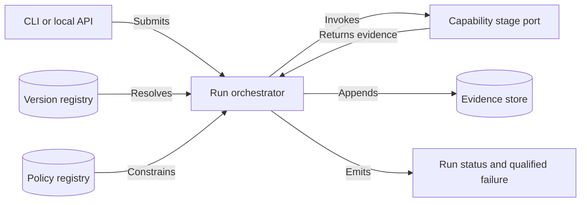
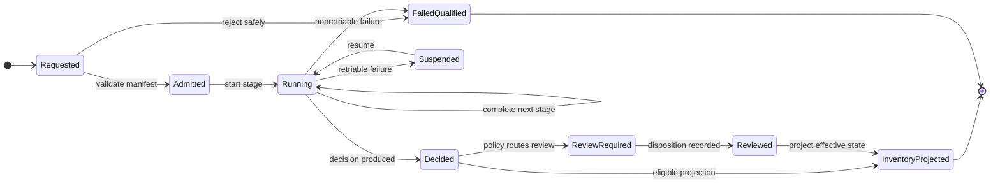

# CAP-001 — Governance, Contract Registry, and Run Orchestration

Status: `REQUIRED / SPECIFIED_CANDIDATE`

Owner role: Architecture and Run-Control Owner (`TO_BE_APPOINTED`)

## Outcome and scope

Provide the control plane that binds every analysis run to authorized scope,
immutable inputs, schema/producer versions, policies, registries, lifecycle,
and restartable state transitions. It excludes domain inference, approval, and
release authorization.

## Requirements and invariants

- Enforce I-02, I-09, and I-11.
- Maintain a version registry for schemas, templates, models, extractors,
  corpora, calibration, and decision policies.
- Admit a run only when required manifests resolve and hashes verify.
- Make transitions idempotent and append-only; changed configuration creates a
  successor run/stage.
- Support `FAILED_QUALIFIED`, cancellation, bounded retry, and resumable work.

## Contracts

Inputs: `RunRequest`, `CaptureRef`, `ConfigurationManifest`, `PolicyBinding`.

Outputs: `AnalysisRun`, `StageExecution`, `RunTransition`, `RunManifest`,
`QualifiedFailure`.

Ports: `VersionRegistry`, `PolicyRegistry`, `StageExecutor`, `EvidenceStore`,
`Clock`, `IdGenerator`. All commands carry idempotency key, actor, purpose,
scope, expected prior state, and correlation ID.

## Behavior, controls, and recovery

Validate configuration, seal the run manifest, execute dependency-ready stages,
persist evidence before transition, and refuse illegal or stale transitions.
Atomic write-then-rename and transaction boundaries prevent partial state.
Recovery replays the last incomplete stage against immutable input. Logs,
metrics, and traces include run/stage/version IDs without embedding untrusted
OCR text in control fields.

## Acceptance evidence

- transition-table, idempotency, stale-version, and illegal-transition tests;
- interrupted-stage recovery with no duplicate semantic outputs;
- manifest completeness and hash verification;
- two clean replays produce equivalent evidence identities;
- role and policy gates never imply approval by artifact existence.

## Dependencies and increments

Upstream: architecture baseline. Downstream: all capabilities.

Increments: contracts/registry -> state machine -> executor/idempotency ->
recovery -> operational control tests.

## Boundary diagram

## State diagram

