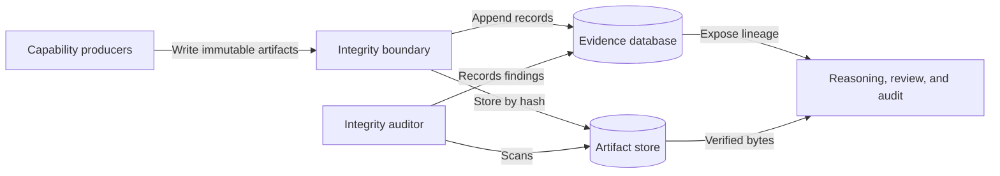
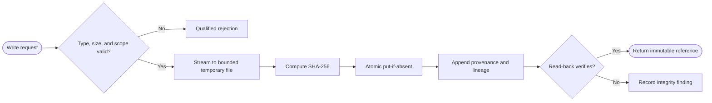

# CAP-002 — Immutable Artifact, Evidence, and Provenance Management

Status: `REQUIRED / SPECIFIED_CANDIDATE`

Owner role: Evidence Integrity Owner (`TO_BE_APPOINTED`)

## Outcome and scope

Persist captures, source snapshots, derivatives, observations, comparisons,
decisions, reviews, and manifests so every claim is reproducible and
challengeable. This capability stores representations; it does not determine
their truth or authority.

## Requirements and invariants

- Enforce I-01, I-02, I-05, and I-08.
- Address immutable binaries and documents by SHA-256.
- Keep reference, observation, and decision truth in separate logical schemas.
- Preserve raw values and append superseding records instead of updating
  history.
- Record producer, schema, source, time, method, environment, and lineage.

## Contracts

Inputs: `ArtifactWriteRequest`, `EvidenceRecord`, `SupersessionAssertion`.

Outputs: `ArtifactRef`, `EvidenceRef`, `LineageEdge`, `IntegrityFinding`.

Stores: content-addressed artifact store; append-only evidence database;
manifest index. Ports support put-if-absent, verified read, lineage traversal,
append, supersede, and integrity audit.

## Behavior, controls, and recovery

Validate type/size, stream to a bounded temporary file, hash, atomically place,
append metadata, and verify read-back. Reject path traversal, hash mismatch,
mutable overwrite, and dangling lineage. Recovery reconciles orphan temporary
files and incomplete metadata without deleting valid evidence. Audit events
identify actor, object, operation, result, and correlation ID.

## Acceptance evidence

- identical content deduplicates while distinct provenance remains represented;
- overwrite and traversal attempts fail closed;
- raw observations survive normalization and review supersession;
- lineage reconstructs source pixels through decision and inventory;
- corruption, orphan, and manifest inconsistency are detected.

## Dependencies and increments

Upstream: CAP-001 contracts. Downstream: every evidence-producing capability.

Increments: artifact addressing -> append-only schemas -> lineage/supersession ->
integrity audit -> corruption/recovery tests.

## Boundary diagram

## Behavior diagram

