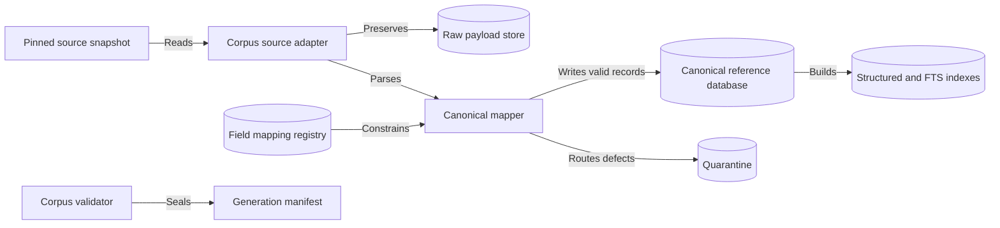
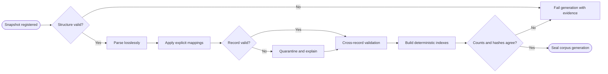

# CAP-003 — Reference Corpus Ingestion and Canonicalization

Status: `REQUIRED / SPECIFIED_CANDIDATE`

Owner role: Reference Data Owner (`TO_BE_APPOINTED`)

## Outcome and scope

Transform pinned source snapshots into a canonical, queryable catalogue of
series, sets, identities, printings, multilingual fields, mechanics, and
qualified variants while preserving raw source and defects. It excludes silent
source acquisition and identity collapse by string similarity alone.

## Requirements and invariants

- Enforce I-01, I-02, I-07, and I-11.
- Implement restartable stages: land, validate, parse, map, quarantine,
  cross-check, index, seal.
- Record mapping dispositions: `mapped`, `preserved-only`, `derived`,
  `unsupported`, `quarantined`.
- Separate `ReferenceCardIdentity` from `ReferencePrinting` and variant claims.
- Detect upstream schema drift, duplicate IDs, collisions, and broken relations.

## Contracts

Inputs: `ReferenceCorpusSnapshot`, `CorpusSourceAdapter`, `FieldMappingRegistry`.

Outputs: reference entities, `SourceFieldMappingDecision`,
`CorpusValidationFinding`, `CorpusGenerationManifest`, deterministic indexes.

Canonical identifiers are stable within a generation and map explicitly to
source identifiers. Migrations preserve source-to-canonical lineage.

## Behavior, controls, and recovery

Fail closed on structural changes; quarantine defective records without hiding
them; complete valid independent partitions where permitted. Rebuild indexes
from canonical rows and verify row counts/checksums before sealing. Metrics
cover input/output/quarantine counts, mapping coverage, collisions, duration,
and generation delta.

## Acceptance evidence

- golden source fixtures and malformed/schema-change fixtures;
- referential, uniqueness, mapping, normalization, and round-trip checks;
- deterministic generation hashes and index counts;
- card identity never implies language/finish/stamp/edition printing facts;
- raw payload remains retrievable for every canonical or quarantined record.

## Dependencies and increments

Upstream: CAP-001, CAP-002. Downstream: CAP-004, CAP-010, CAP-011, CAP-014.

Increments: source adapter -> raw landing -> canonical schema/mapping ->
validation/quarantine -> indexes/delta/seal.

## Boundary diagram

## Behavior diagram

