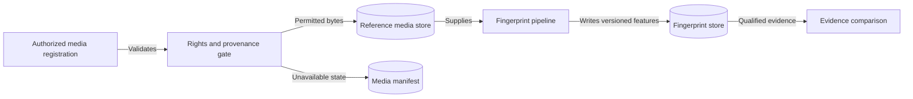
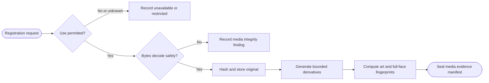

# CAP-004 — Governed Reference Media and Fingerprinting

Status: `REQUIRED / SPECIFIED_CANDIDATE`

Owner role: Media Rights and Reference Evidence Owner (`TO_BE_APPOINTED`)

## Outcome and scope

Register permitted reference images, rights/provenance state, derivatives, and
art/full-face fingerprints for qualified comparison. Missing or restricted
media remains an explicit state. The capability does not crawl, download, or
redistribute media without separate authority.

## Requirements and invariants

- Enforce I-01 and I-07.
- Track source, rights basis, permitted purposes, retrieval event, hash,
  dimensions, color profile, derivative/fingerprint versions, and expiry.
- Separate artwork similarity from full-face and printing-specific evidence.
- Prevent a reused artwork match from proving printing identity.
- Invalidate fingerprints when source bytes or algorithm version changes.

## Contracts

Inputs: `ReferenceMediaRegistration`, permitted bytes, reference-printing link,
fingerprint profile.

Outputs: `ReferenceCardImage`, `ReferenceImageFingerprint`, `MediaRightsState`,
`MediaIntegrityFinding`.

Rights states: `PERMITTED`, `RESTRICTED`, `UNKNOWN`, `EXPIRED`, `UNAVAILABLE`.

## Behavior, controls, and recovery

Verify authority metadata before accepting bytes, validate/decode safely,
content-address the original, generate bounded derivatives, compute versioned
fingerprints, and link them to the appropriate identity/printing scope. Never
log or export restricted image bytes accidentally. Recovery regenerates
derivatives from immutable originals when permitted.

## Acceptance evidence

- rights-state matrix and prohibited-operation tests;
- corrupt/oversized/decompression-bomb input tests;
- deterministic fingerprint fixtures and algorithm-version invalidation;
- reused-art and near-identical-printing counterexamples;
- unavailable media reduces evidence eligibility without failing the run.

## Dependencies and increments

Upstream: CAP-002, CAP-003. Downstream: CAP-010, CAP-011, CAP-014, CAP-015.

Increments: rights manifest -> secure media store -> derivatives -> fingerprints
-> counterexample benchmark.

## Boundary diagram

## Behavior diagram

