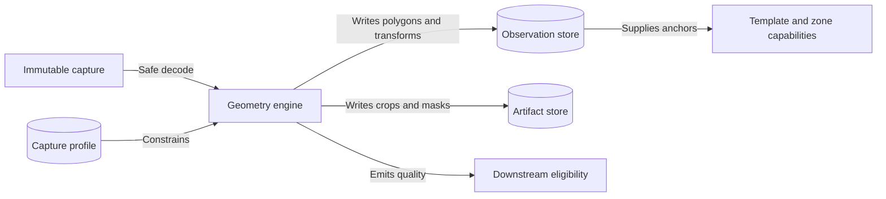
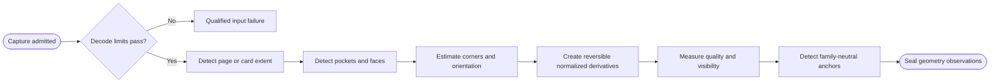

# CAP-005 — Capture Geometry, Normalization, and Quality Assessment

Status: `REQUIRED / SPECIFIED_CANDIDATE`

Owner role: Capture and Geometry Owner (`TO_BE_APPOINTED`)

## Outcome and scope

Convert an immutable capture into page, pocket, and card-face observations with
orientation, reversible coordinates, normalized derivatives, anchors, and
quality evidence. It does not infer card identity or silently discard poor
captures.

## Requirements and invariants

- Enforce I-01, I-02, and I-12.
- Support binder pages, single cards, empty pockets, backs, partial/rotated
  cards, and non-nine-pocket layouts when declared in scope.
- Preserve source-to-normalized transforms, polygons, masks, and crop completeness.
- Measure blur, glare, skew, perspective, occlusion, shadow, color cast,
  compression, and effective pixels.
- Emit qualified failures and recapture guidance.

## Contracts

Inputs: `Capture`, `CaptureProfile`, decoder/geometry policy.

Outputs: `PageObservation`, `PocketObservation`, `CardFaceObservation`,
`GeometryObservation`, `QualityObservation`, `AnchorObservation`, derivatives.

Every derivative references exact source polygon, transform, method, and
producer version.

## Behavior, controls, and recovery

Validate magic/dimensions/decompression bounds; detect page/slots/faces;
estimate corners/orientation; normalize; measure quality; locate family-neutral
anchors; persist observations and artifacts. Stage results are deterministic
within configured tolerances. Failed detections retain diagnostics and permit
manual geometry or recapture as separately attributable input.

## Acceptance evidence

- detection precision/recall, corner error, pocket ordering, crop completeness;
- rotation, perspective, glare, blur, empty/back/partial and adversarial inputs;
- coordinate round-trip tolerance tests;
- deterministic derivative hashes where the implementation guarantees them;
- downstream stages receive explicit quality eligibility, not assumed quality.

## Dependencies and increments

Upstream: CAP-001, CAP-002. Downstream: CAP-006, CAP-008, CAP-009, CAP-014.

Increments: safe decode -> page/slot geometry -> card normalization -> quality ->
anchors -> broad fixture benchmark.

## Boundary diagram

## Behavior diagram

