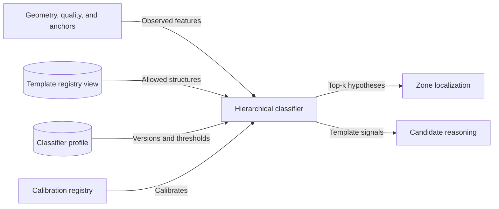
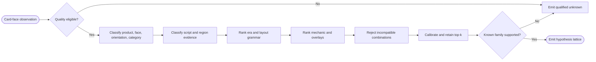

# CAP-006 — Hierarchical Template Classification

Status: `REQUIRED / SPECIFIED_CANDIDATE`

Owner role: Template Classification Owner (`TO_BE_APPOINTED`)

## Outcome and scope

Produce a calibrated lattice of compatible template hypotheses across product,
face state, orientation, category, script, era, mechanic, region, exception,
and printing overlays. It does not assert a template fact or use a template-
specific crop to prove that same template.

## Requirements and invariants

- Enforce I-03, I-11, and I-12.
- Combine geometry/color features, family-neutral anchors, script evidence,
  symbols, optional learned layout models, and explicit constraints.
- Preserve top-k alternatives, reasons, disagreement, and out-of-distribution
  indicators with an `UNKNOWN_FAMILY` escape.
- Keep language, script, and region as separately evidenced dimensions.
- Accept posterior candidate feedback only as labeled later evidence.

## Contracts

Inputs: card-face/geometry/quality/anchor observations, template registry view,
classifier profile, optional prior-neutral preliminary observations.

Outputs: `TemplateHypothesis[]`, hierarchy-level scores/reasons,
`ClassifierDisagreement`, `OutOfDistributionFinding`.

The port is deterministic for a fixed manifest except explicitly declared model
nondeterminism, which must be seeded and recorded.

## Behavior, controls, and recovery

Check quality eligibility; classify coarse-to-fine; prune only impossible
combinations; calibrate by hierarchy stratum; retain alternatives; stop at the
deepest evidence-supported level. Model/provider failure falls back to
available independent methods and qualifies reduced evidence rather than
inventing a label.

## Acceptance evidence

- top-1/top-k accuracy, hierarchy confusion, Brier/ECE calibration;
- unknown-family/OOD recall and false-known rate;
- language/script/region separation fixtures;
- counterfactual tests proving preliminary crops do not assume target template;
- performance by era/category/mechanic/capture-quality stratum.

## Dependencies and increments

Upstream: CAP-001, CAP-005, CAP-007, CAP-014 fixtures. Downstream: CAP-008,
CAP-010, CAP-011, CAP-012.

Increments: feature contract -> deterministic coarse levels -> constraint solver
-> calibrated top-k -> OOD/learned model -> posterior reconciliation.

## Boundary diagram

## Behavior diagram

