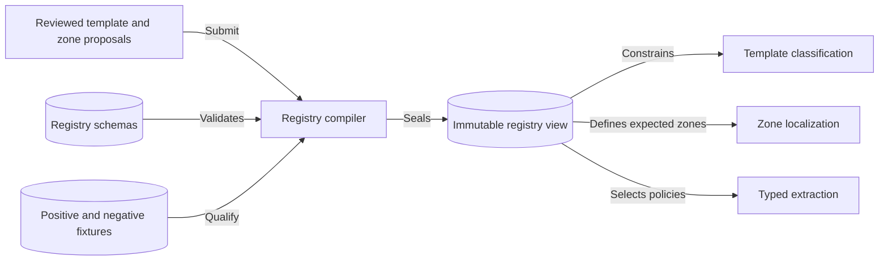
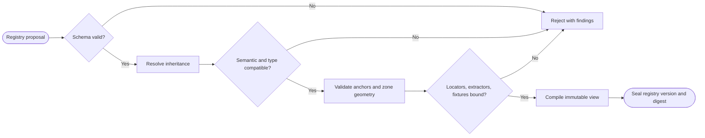

# CAP-007 — Template Registry and Semantic Zone Ontology

Status: `REQUIRED / SPECIFIED_CANDIDATE`

Owner role: Template and Zone Semantics Owner (`TO_BE_APPOINTED`)

## Outcome and scope

Define versioned template families, inheritance, applicability, anchors,
semantic zones, relationships, locator/extractor policies, known confusions,
fixtures, and compatibility envelopes. A registry definition describes expected
structure; it is not evidence that a zone was observed.

## Requirements and invariants

- Enforce I-03, I-04, and I-11.
- Cover identity, classification, numeric, type/cost, mechanics, matchups,
  catalogue, legality/era, attribution, printing, artwork, special, and footer
  zone families.
- Require positive and negative predicates, lifecycle, provenance, and fixtures.
- Preserve semantic identity/type through child overrides.
- Detect cycles, incompatible overrides, impossible geometry, exclusive-zone
  overlap, missing locators/extractors, and unbound anchors.

## Contracts

Inputs: reviewed taxonomy/zone proposals, fixtures, migration/compatibility
decision.

Outputs: `CardTemplateFamily`, `ZoneDefinition`, `AnchorDefinition`,
`TemplateCompatibilityEnvelope`, `RegistryValidationFinding`, sealed registry.

Each zone defines cardinality, applicability, requiredness, data type, expected
polygon, locator strategy, extractor policy, validators, reliability prior,
quality limits, fallbacks, and presence states.

## Behavior, controls, and recovery

Parse schema, resolve inheritance, validate semantic/type compatibility, compile
an immutable registry view, and seal its digest. Invalid registries never become
active. Successor versions include migrations or explicitly invalidate old
run evidence. Registry audit exposes coverage by template and zone family.

## Acceptance evidence

- schema, inheritance-cycle, override/type, coordinate, overlap, and binding tests;
- fixtures and counterexamples for every active template family;
- zone coverage matrix with no implied runtime detection;
- backward/forward compatibility and migration decisions;
- compiled-view digest reproducibility.

## Dependencies and increments

Upstream: CAP-001, CAP-003 domain fields, CAP-014 truth conventions. Downstream:
CAP-006, CAP-008, CAP-009, CAP-010, CAP-014.

Increments: ontology/schema -> inheritance compiler -> validators -> fixtures and
coverage -> migrations/lifecycle.

## Boundary diagram

## Behavior diagram

