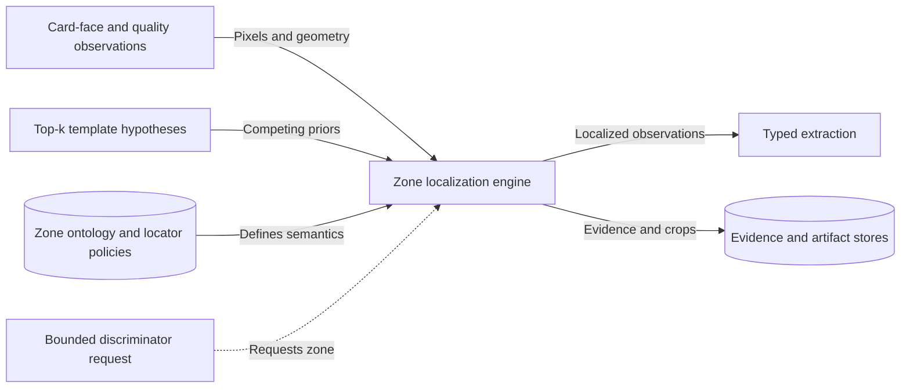
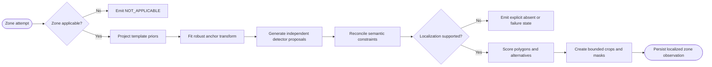

# CAP-008 — Semantic Zone Localization

Status: `REQUIRED / SPECIFIED_CANDIDATE`

Owner role: Zone Localization Owner (`TO_BE_APPOINTED`)

## Outcome and scope

Identify the observed polygon and presence/quality state of every applicable
semantic information zone on a specific card face. It combines template priors,
anchor refinement, independent detector proposals, and bounded candidate-
conditioned alternatives without converting a definition into an observation.

## Requirements and invariants

- Enforce I-04, I-11, and I-12.
- Emit prior and localized polygons, transform, anchors, method, confidence,
  source/normalized coordinates, visibility, completeness, glare, blur, and
  effective pixels.
- Represent repeated structures as zone-instance arrays.
- Use `ABSENT`, `NOT_APPLICABLE`, `NOT_LOCALIZED`, `OCCLUDED`, or `UNREADABLE`.
- Preserve alternatives and explicitly model permitted overlap.

## Contracts

Inputs: card-face/geometry/quality observations, top-k template hypotheses,
registry view, optional discriminator request.

Outputs: `LocalizedZoneObservation[]`, `ZoneAlternative[]`,
`ZoneLocalizationFinding`, zone crop/mask references.

Candidate-conditioned requests may select a zone attempt but cannot mutate
prior localization evidence or run unbounded loops.

## Behavior, controls, and recovery

Project priors for each compatible template; fit robust anchor transforms;
generate text/symbol/logo/repeated-row proposals; reconcile proposals under
semantic constraints; score alternatives; crop safely; persist explicit state.
Failure is isolated per zone and does not erase successful independent zones.

## Acceptance evidence

- polygon IoU, edge error, presence-state accuracy, crop completeness per zone;
- localization precision/recall by template, quality, language, and zone family;
- repeated attack/cost and special-layout fixtures;
- alternative/ambiguity and occlusion/unreadable tests;
- candidate feedback loop terminates within configured rounds.

## Dependencies and increments

Upstream: CAP-001, CAP-002, CAP-005, CAP-006, CAP-007. Downstream: CAP-009,
CAP-010, CAP-011, CAP-014.

Increments: static priors -> anchor transforms -> independent proposals ->
constraint reconciliation -> alternatives/presence -> discriminator feedback.

## Boundary diagram

## Behavior diagram

