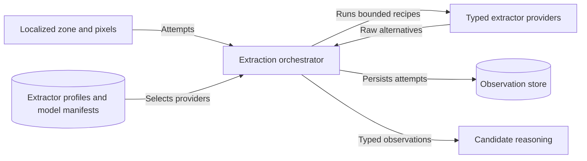
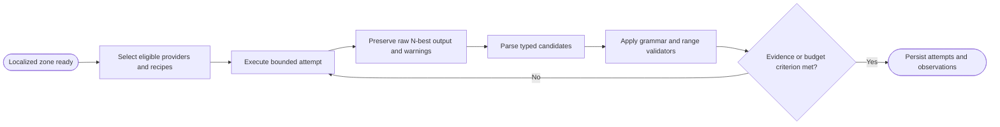

# CAP-009 — Typed Extraction Ensemble

Status: `REQUIRED / SPECIFIED_CANDIDATE`

Owner role: Observation Extraction Owner (`TO_BE_APPOINTED`)

## Outcome and scope

Produce replayable raw and typed observations from localized zones using
bounded, semantics-aware extractor ensembles. Candidate lexicons may rank
alternatives but may not overwrite raw outputs.

## Requirements and invariants

- Enforce I-05, I-11, and I-12.
- Support script-aware text, numeric fields, symbols, line/word geometry,
  artwork/full-face features, optical surface hypotheses, and specialized zones.
- Version model code, model data, preprocessing, lexicon, parameters, seed,
  budget, warnings, and failures.
- Preserve N-best raw outputs and explicit confusion transforms.
- Bound retries by evidence gain or budget.

## Contracts

Inputs: `LocalizedZoneObservation`, zone pixels/mask, extractor policy,
model/profile registry, optional candidate lexicon.

Outputs: `ExtractorAttempt`, `TextObservation`, `NumericObservation`,
`SymbolObservation`, `VisualFeatureObservation`, `ExtractionFailure`.

Providers conform to typed ports and declare supported zone types, quality
requirements, runtime isolation, and licensing/model-data status.

## Behavior, controls, and recovery

Select eligible providers/recipes; execute in isolated bounded workers where
needed; retain raw alternatives; parse typed values; apply validators; determine
whether more attempts add material evidence; persist every attempt. Provider
failure is contained and can fall back without hiding the failure.

## Acceptance evidence

- character/word/field accuracy, symbol F1, numeric exact match, N-best recall;
- measures by zone, language, template, quality, and provider profile;
- raw-to-normalized round-trip and confusion-transform tests;
- timeout/crash/license-unavailable/model-mismatch failure tests;
- repeated preprocessing variants are marked correlated downstream.

## Dependencies and increments

Upstream: CAP-001, CAP-002, CAP-007, CAP-008, CAP-014 fixtures. Downstream:
CAP-010, CAP-011, CAP-014.

Increments: attempt contract -> text/numeric -> symbols -> visual/specialized ->
ensemble stopping -> isolated provider/reliability benchmark.

## Boundary diagram

## Behavior diagram

