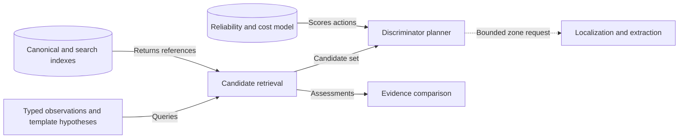
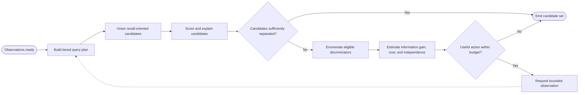

# CAP-010 — Candidate Retrieval and Active Discrimination

Status: `REQUIRED / SPECIFIED_CANDIDATE`

Owner role: Candidate Reasoning Owner (`TO_BE_APPOINTED`)

## Outcome and scope

Retrieve a recall-oriented, explainable candidate set from canonical reference
truth and select the next affordable independent evidence action that best
separates unresolved candidates. It does not confirm identity.

## Requirements and invariants

- Enforce I-01, I-06, I-11, and I-12.
- Use tiered structured identifiers, multilingual names, template/category/
  language/era/mechanic constraints, detailed fields, then permitted images.
- Explain every inclusion, exclusion, score component, and hard filter.
- Apply hard filters only to well-formed high-confidence observations.
- Bound discriminator rounds, total cost, and recursion; record termination.

## Contracts

Inputs: typed observations, template hypotheses, canonical indexes, media
availability, reliability/cost model, prior candidate set.

Outputs: `CandidateQueryPlan`, `CandidateSet`, `CandidateAssessment`,
`MissingDiscriminator`, `DiscriminatorPlan`, `RetrievalTermination`.

The planner may request a semantic zone/extractor attempt through CAP-008/009;
it cannot rewrite observations or bypass run-control budgets.

## Behavior, controls, and recovery

Build explainable query tiers, union candidates for recall, score with weak
signals, evaluate candidate entropy/disagreement, enumerate visible eligible
discriminators, estimate information gain adjusted by reliability/cost/
independence, request the best action, and terminate on evidence/budget/no-gain.

## Acceptance evidence

- top-1/5/10/25 and no-match recall before pruning optimization;
- candidate inclusion/exclusion explanation completeness;
- hard-filter safety and malformed-observation fixtures;
- planner selection compared with known discriminative fixtures;
- bounded termination under no media, unreadable zones, and stable ambiguity.

## Dependencies and increments

Upstream: CAP-001, CAP-003, CAP-004, CAP-006, CAP-008, CAP-009. Downstream:
CAP-011, CAP-012, CAP-014.

Increments: structured/text recall -> explanation -> detailed-field/image tiers
-> missing-discriminator model -> information-gain planner -> bounded loop.

## Boundary diagram

## Behavior diagram

