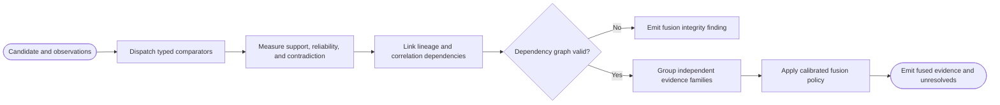

# CAP-011 — Typed Evidence Comparison and Dependency-Aware Fusion

Status: `REQUIRED / SPECIFIED_CANDIDATE`

Owner role: Evidence Fusion Owner (`TO_BE_APPOINTED`)

## Outcome and scope

Compare typed observations with candidate expectations, record contradictions
and evidence dependencies, and produce calibrated fused evidence without
double-counting correlated observations. It does not issue the final identity
decision.

## Requirements and invariants

- Enforce I-05, I-06, and I-11.
- Provide text, number, symbol, ordered/multiset, geometry/template, artwork,
  full-face, and printing-specific comparators.
- Record observed/expected values, method, strength, reliability,
  applicability, independence family, contradiction, and evidence refs.
- Model lineage/correlation between preprocessing variants and posterior matches.
- Preserve missing and inapplicable evidence without treating either as negative.

## Contracts

Inputs: candidate assessments, observations, reference expectations, comparator
registry, dependency policy, calibration records.

Outputs: `EvidenceComparison[]`, `Contradiction[]`, `EvidenceDependencyGraph`,
`FusedEvidenceSummary`, `FusionFinding`.

Comparators are pure/versioned where practical; fusion consumes comparison
objects and never reads raw OCR or corpus rows directly.

## Behavior, controls, and recovery

Dispatch by data type; calculate support/contradiction; create dependency edges;
validate graph; group correlated families; aggregate with calibrated policy;
emit candidate-level evidence summaries and unresolved conflicts. A comparator
failure yields missing evidence and a finding, not neutral support.

## Acceptance evidence

- comparator golden/counterexample fixtures by data type;
- dependency/correlation tests preventing repeated-attempt vote inflation;
- contradiction taxonomy and hard-contradiction propagation;
- calibration and sensitivity checks by benchmark stratum;
- missing/inapplicable/provider-failure semantics.

## Dependencies and increments

Upstream: CAP-002, CAP-003, CAP-004, CAP-006, CAP-008, CAP-009, CAP-010,
CAP-014. Downstream: CAP-012, CAP-013, CAP-014.

Increments: typed comparison contract -> comparator suite -> contradiction model
-> dependency graph -> calibrated fusion -> sensitivity/regression.

## Boundary diagram

```mermaid
flowchart LR
    observations["Typed observations"] -->|"Observed values"| compare["Comparator registry"]
    candidates["Candidate expectations"] -->|"Expected values"| compare
    compare -->|"Typed comparisons"| graph["Evidence dependency graph"]
    policy[("Calibration and dependency policy")] -->|"Constrains"| fusion["Fusion engine"]
    graph -->|"Independent families and contradictions"| fusion
    fusion -->|"Fused summaries"| decision["Abstaining decision engine"]
```

## Behavior diagram


