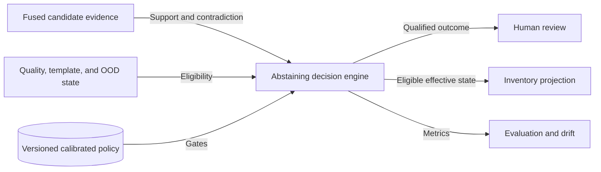
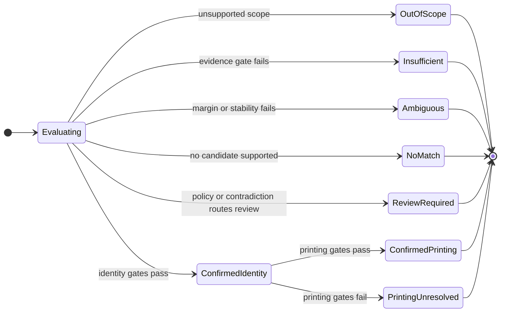

# CAP-012 — Abstaining Identity and Printing Decision

Status: `REQUIRED / SPECIFIED_CANDIDATE`

Owner role: Identification Policy Owner (`TO_BE_APPOINTED`)

## Outcome and scope

Issue a versioned, evidence-qualified machine outcome for card identity and a
separate outcome for printing/variant identity. Prefer unknown, insufficient,
ambiguous, or review-required over unsupported confirmation.

## Requirements and invariants

- Enforce I-01, I-06, and I-12.
- Require minimum evidence mass, independent families, margin/top-k stability,
  quality eligibility, no hard contradiction, and OOD/template gates.
- Bind confidence to benchmark strata and policy version.
- Separate card identity from printing/variant state.
- Emit unresolved discriminators, review/recapture recommendations, and reasons.

## Contracts

Inputs: fused candidate summaries, contradictions, quality/template/OOD states,
calibrated decision policy.

Outputs: `IdentificationDecision` with state, identity scope, selected reference
if any, confidence, evidence families, contradictions, unresolveds, policy and
benchmark bindings.

States: `CONFIRMED`, `AMBIGUOUS`, `INSUFFICIENT_EVIDENCE`, `NO_MATCH`,
`OUT_OF_SCOPE`, `REVIEW_REQUIRED`, `FAILED_QUALIFIED`.

## Behavior, controls, and recovery

Validate policy/benchmark compatibility, apply eligibility and contradiction
gates, evaluate evidence/margin/stability, decide identity, separately decide
printing, and route review/inventory. Policy changes create successor decisions;
they never mutate earlier records. Automatic confirmation is disabled until
CAP-014 supplies adopted thresholds.

## Acceptance evidence

- exact identity and printing accuracy, false-confirmation and unresolved rates;
- calibration by template/language/quality/variant strata;
- reused-art, reprint, near-identical, OOD, conflict, and no-match fixtures;
- policy-version/supersession tests;
- explicit proof that candidate rank alone cannot confirm.

## Dependencies and increments

Upstream: CAP-001, CAP-002, CAP-006, CAP-010, CAP-011, CAP-014. Downstream:
CAP-013, CAP-014, CAP-015.

Increments: state/reason contract -> safety gates -> identity policy -> printing
policy -> calibration binding -> adversarial false-confirmation suite.

## Boundary diagram

## State diagram

