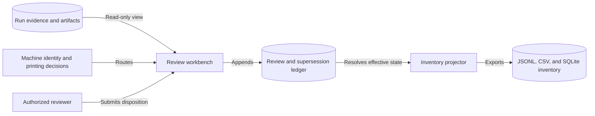
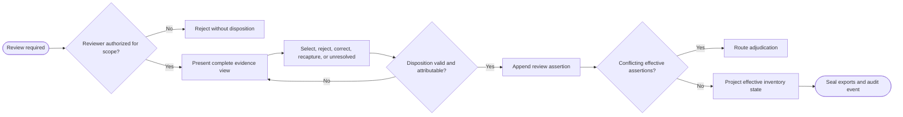

# CAP-013 — Human Review, Supersession, and Inventory Projection

Status: `REQUIRED / SPECIFIED_CANDIDATE`

Owner role: Review and Inventory Product Owner (`TO_BE_APPOINTED`)

## Outcome and scope

Provide an evidence-rich review workbench, capture attributable dispositions as
append-only superseding assertions, and project the latest effective state into
inventory. Review does not rewrite machine evidence, and inventory is not the
source of truth.

## Requirements and invariants

- Enforce I-08, I-09, and I-12.
- Display source/page/pocket geometry, quality, template hypotheses, zone map,
  crops/alternatives, candidates, references, evidence dependencies,
  contradictions, and missing discriminators.
- Support select candidate, reject all, correct field, request recapture, and
  leave unresolved with actor/reason/scope.
- Separate identity and printing dispositions.
- Preserve stable physical location across reprocessing.

## Contracts

Inputs: analysis run, machine decision, evidence graph, permitted references,
reviewer identity/authority.

Outputs: `HumanReviewDisposition`, `SupersedingAssertion`, `ReviewAuditEvent`,
`InventoryCardInstance`, JSONL/CSV/SQLite projections.

Effective-state projection resolves supersession deterministically and retains
links to all supporting/historical records.

## Behavior, controls, and recovery

Authorize reviewer scope; render evidence; validate disposition; append signed
attribution; compute effective state; generate non-overwriting inventory
projection. Concurrent reviews produce a conflict state requiring adjudication.
Sensitive source/reference media follows CAP-004 permissions. Draft UI state is
recoverable without representing an unsubmitted review as a disposition.

## Acceptance evidence

- role/scope authorization and attribution tests;
- append-only correction, supersession, and conflict-resolution fixtures;
- identity/printing separation and unresolved preservation;
- deterministic inventory projection and export schema validation;
- usability/accessibility review and evidence-completeness checks.

## Dependencies and increments

Upstream: CAP-001, CAP-002, CAP-004, CAP-008, CAP-009, CAP-010, CAP-011,
CAP-012. Downstream: CAP-014, CAP-015.

Increments: review read model -> disposition contract -> supersession resolver ->
inventory projection -> workbench -> accessibility/concurrency hardening.

## Boundary diagram

## Behavior diagram

