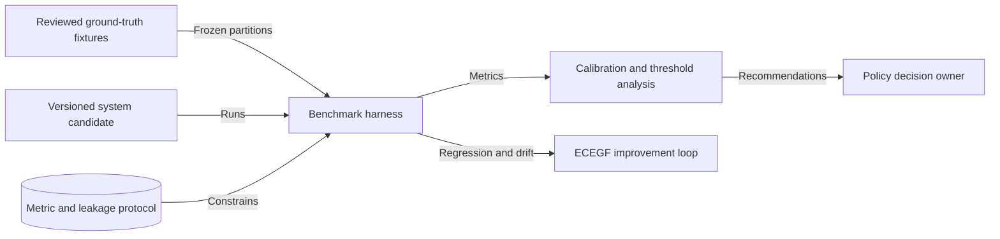
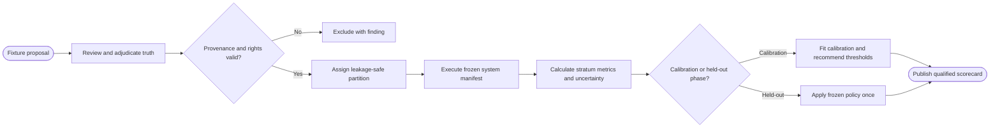

# CAP-014 — Ground Truth, Evaluation, Calibration, and Drift Control

Status: `REQUIRED / SPECIFIED_CANDIDATE`

Owner role: Independent Evaluation Owner (`TO_BE_APPOINTED`)

## Outcome and scope

Create governed reviewed truth, leakage-safe partitions, benchmarks,
calibration, thresholds, regression fixtures, and drift findings for every
claimed capability and stratum. Evaluation evidence informs policy; it does not
authorize release.

## Requirements and invariants

- Enforce I-09, I-10, and I-11.
- Cover historical/modern layouts, claimed languages/categories/printings,
  capture defects, reused art, near-identical printings, empty/backs/OOD.
- Separate development, calibration, and held-out evaluation with no
  near-duplicate/reference leakage.
- Measure geometry, classification, localization, extraction, retrieval,
  identity/printing decisions, calibration, and operations by stratum.
- Make false automatic confirmation the primary safety metric.

## Contracts

Inputs: `GroundTruthFixture`, annotations, rights/provenance, system version,
benchmark protocol, candidate policy.

Outputs: `BenchmarkRun`, `MetricResult`, `CalibrationModel`,
`ThresholdRecommendation`, `RegressionFinding`, `DriftFinding`, scorecard.

Truth changes are versioned adjudications and invalidate only affected
measurements. Threshold recommendations require a separate adoption decision.

## Behavior, controls, and recovery

Register/adjudicate fixtures; detect leakage; freeze partitions; execute exact
system manifest; calculate confidence intervals and stratum metrics; calibrate
on calibration only; evaluate held-out once under policy; compare baselines;
emit falsifiers/findings. Failed or partial benchmarks remain evidence with
explicit incompleteness.

## Acceptance evidence

- inter-annotator/adjudication and annotation-schema validation;
- partition/leakage and rights/provenance audits;
- reproducible metric calculations with uncertainty;
- calibration reliability and false-confirmation ceiling tests;
- regression/drift detection on seeded failures and known counterexamples.

## Dependencies and increments

Upstream foundation: CAP-001, CAP-002. Measures CAP-003 through CAP-015.
Downstream: CAP-006, CAP-011, CAP-012, CAP-015 and lifecycle review.

Increments: truth protocol -> annotation/fixture registry -> split/leakage ->
component metrics -> calibration -> held-out/e2e -> drift and regression.

## Boundary diagram

## Behavior diagram

