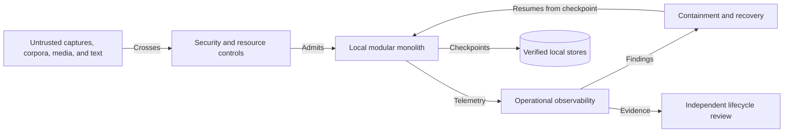
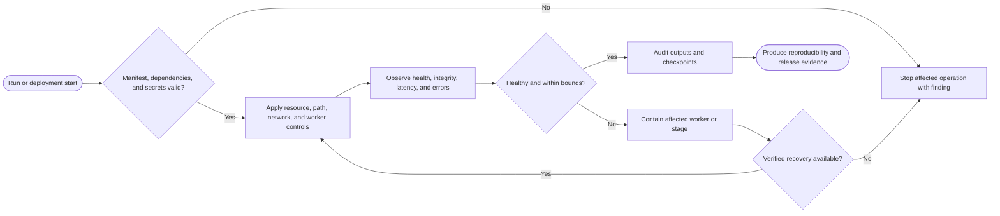

# CAP-015 — Security, Reliability, Recovery, and Reproducible Operations

Status: `REQUIRED / SPECIFIED_CANDIDATE`

Owner role: Security and Operations Owner (`TO_BE_APPOINTED`)

## Outcome and scope

Operate the local-first modular monolith within explicit trust boundaries with
safe input handling, bounded resources, reliable recovery, observability,
dependency/license controls, deterministic replay, and governed release
evidence. It does not provide release approval.

## Requirements and invariants

- Enforce I-02, I-07, and I-09.
- Treat captures, corpora, media, OCR output, and embedded text as untrusted.
- Enforce decoder/resource/path/write/network boundaries and secret hygiene.
- Use atomic writes, backup/restore, bounded retry/timeouts, worker isolation,
  and deterministic recovery.
- Record code/data/model/media licensing and redistribution separately.
- Provide SLO candidates only after measured baselines; unknown targets remain
  `EvidenceRequired`.

## Contracts

Inputs: deployment/run manifest, local configuration, threat/control register,
dependency/SBOM data, backup policy, operational events.

Outputs: `OperationalRunRecord`, `SecurityFinding`, `RecoveryRecord`,
`ReproducibilityReport`, `DependencyFinding`, `ReleaseEvidencePacket`.

Ports separate network synchronization from offline analysis. Diagnostics are
structured, privacy-minimized, and bound to run/capability IDs.

## Behavior, controls, and recovery

Verify environment/dependencies/secrets; enforce least privilege and write
root; start isolated workers; observe latency/error/resource/integrity signals;
trip bounded circuit/timeout controls; recover from last verified checkpoint;
audit outputs; produce a release evidence packet. Incidents preserve evidence
and trigger scoped containment, not silent data repair.

## Acceptance evidence

- threat model/control verification and malicious input fixtures;
- path traversal, oversized/decompression, malformed source, and secret scans;
- power-loss/interruption, partial-write, worker crash, backup/restore tests;
- deterministic replay and dependency/SBOM/license reports;
- operational load/latency baselines and incident/runbook exercises;
- independent security/QA/licensing/release dispositions remain required.

## Dependencies and increments

Upstream: CAP-001, CAP-002 and operational outputs from all capabilities;
qualification requires CAP-014. Downstream: lifecycle decision.

Increments: threat/control model -> resource/write boundaries -> observability ->
failure/recovery -> backup/restore -> dependency/license -> release evidence.

## Boundary diagram

## Behavior diagram

