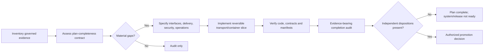

# Skill Selection and Custom Strategy

## Strategic disposition

ThinkLikeACIO classified the request as `AUTHORIZED_EXECUTION` for local,
reversible repository work. Symbiotic Strategic Agility for Complexity admitted
it as `ADMIT_QUALIFIED`: architecture and planning may advance, but no tool or
document may proxy for accountable production approval.

## Selected capabilities

| Capability | Selection reason | Produced effect |
|---|---|---|
| ThinkLikeACIO | establish authority, truth, lifecycle and operating boundaries | separated plan completeness from implementation/release status |
| Symbiotic Strategic Agility for Complexity | preserve actor, state and decision boundaries under uncertainty | recorded qualified admission, stop conditions and human gates |
| Finding the Right Skill by Capability | minimize skill set while covering actual gaps | selected six supporting skills rather than rerunning the full discovery estate |
| RequestDocumentation | derive document obligations and diagram/context needs | converted architectural requirements into this package index |
| TurnContextIntoProject | form governed project artifacts from accumulated context | established charter, scope, backlog, roles and delivery controls |
| Dependency Graph to Sequenced Prompt Pipeline | compile dependencies into executable ordering | produced the wave/critical-path plan |
| Governed Capability-Orchestrated Project Execution | bind actions to authority and evidence gates | defined stage entry/exit, escalation and stop conditions |
| Evidence-Bearing Completion Contract and Audit | prevent narrative completion claims | produced the final traceability and two-level completion audit |

The prior Capability Factory, future-state projection, ECEGF analysis,
MetaPrompt reconstruction and invariant analysis were accepted as governed
inputs because their artifacts already existed and passed an inventory check.
They were not rerun performatively.

## Custom strategy

The strategy optimizes for optionality: one modular-monolith core, adapters at
the edge, local-first stores, immutable evidence, versioned contracts, and
asynchronous production evolution without premature service decomposition.

## Invariants carried forward

1. Reference truth, observations, hypotheses, decisions and review actions are
   different object types and must never be collapsed.
2. A template declaration is not a detected template; a zone definition is not
   a localized zone observation.
3. Unknown, unlocalized, unsupported and insufficient-evidence states are valid.
4. New evidence supersedes; it does not overwrite history.
5. Every threshold is either measured and versioned or `EvidenceRequired`.
6. Validation evidence informs but does not authorize lifecycle promotion.
