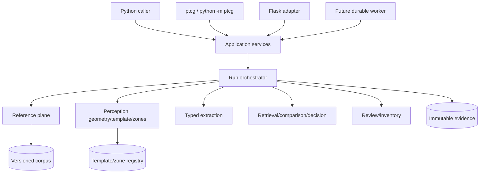
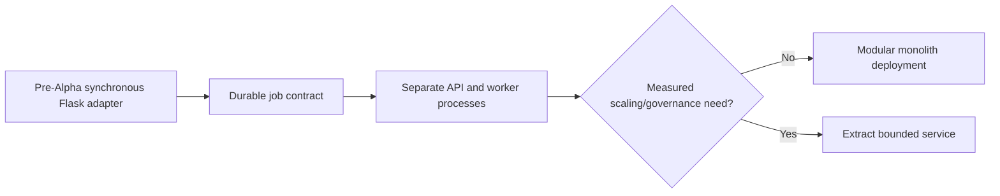

# Application Architecture and Execution Profiles

## Strategic architecture

Retain a Python modular monolith until evidence demonstrates an independently
scaling or separately governed component. Transport adapters depend on an
application service layer; the application layer depends on domain contracts;
domain code does not import Flask, CLI parsers, Docker or infrastructure.

## Component boundaries

| Boundary | Owns | Must not own |
|---|---|---|
| Transport | input decoding, auth context, request IDs, response mapping | detection or decision policy |
| Application | use-case orchestration, idempotency, unit-of-work, job state | framework request objects |
| Domain | contracts, evidence semantics, policy and state transitions | filesystem/network implementation |
| Adapters | OCR/model/corpus/blob implementations | authoritative business truth |
| Evaluation | truth sets, metrics, calibration and promotion evidence | release approval |

## Current implemented slice

- `ptcg.service.analyze_page_request` is the shared service entry.
- `ptcg` and `python -m ptcg` call that service.
- `ptcg-api` and `ptcg.api:create_app()` expose a thin Flask transport.
- `Dockerfile` builds one non-root image; `compose.yaml` selects CLI or API.
- `/healthz`, `/readyz` and synchronous `/v1/pages/analyze` are implemented.

This is a transport-enablement increment. It does not add the target classifier,
all-zone localizer, durable job control, auth, production telemetry or scale.

## Target execution profiles

| Profile | Invocation | Intended use | Guardrail |
|---|---|---|---|
| Python | `analyze_page_request(...)` then target typed services | tests, notebooks, embedded backend | no transport concerns in domain |
| CLI | `ptcg ...` or `python -m ptcg ...` | local/batch/admin/replay | structured output and stable exit codes |
| Local HTTP | `ptcg-api` | developer integration only | loopback default, synchronous and bounded |
| Production HTTP | WSGI/API + durable queue + worker | controlled service deployment | authentication, async jobs, quotas, audit |
| Container CLI | `docker compose run --rm cli ...` | reproducible local operation | explicit mounts, non-root, no egress by default |
| Container API | `docker compose up api` | local integration | loopback publish, read-only root FS |

## Deployment evolution

Flask is selected as the adapter because the current use case needs a small
WSGI surface, not an async framework rewrite. FastAPI remains a compatible
future adapter if validated requirements demand generated clients or ASGI
concurrency; it must consume the same application contracts.

## Data flow invariant

`SourceCapture → CardFaceObservation → TemplateHypothesis → ZoneObservation[] →
CandidateSet → ComparisonEvidence[] → IdentificationDecision → ReviewAction[] →
InventoryProjection`.

Every arrow records object IDs and producing version. No downstream component
may mutate an upstream object.
