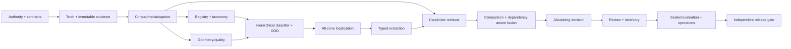

# Work Breakdown and Critical Path

## Sequenced delivery waves

| Wave | Work packages | Entry | Exit evidence |
|---|---|---|---|
| W0 Govern | WP-001–004 | G0 roles/authority | accepted contracts, taxonomy method, ADRs, evidence policy |
| W1 Preserve truth | WP-005–009 | W0 | immutable store, lineage graph, truth protocol, sealed split |
| W2 Establish inputs | WP-010–017 | W1 | reconciled corpus/media and measured capture geometry |
| W3 Interpret semantics | WP-018–026 | W2 | registry, hierarchical classifier, OOD and all-zone localization |
| W4 Extract and reason | WP-027–035 | W3 | typed extractors, recall retrieval, bounded planning, fusion |
| W5 Decide and review | WP-036–041 | W4 | abstention policy, attributed review and inventory projection |
| W6 Qualify operations | WP-042–052 | W5 | benchmark, security, load, recovery, SLO and release evidence |

## Work-package register

| ID | Deliverable | Owner role | Depends | Acceptance |
|---|---|---|---|---|
| WP-001 | authority/RACI/decision log | Capability Owner | — | roles accept boundaries |
| WP-002 | canonical schemas and lifecycle rules | Tech Lead | WP-001 | compatibility suite passes |
| WP-003 | run manifest/state machine/idempotency | Tech Lead | WP-002 | crash/retry model reviewed |
| WP-004 | ADR baseline and dependency policy | Tech Lead/Security | WP-001 | approved ADR set and SBOM rule |
| WP-005 | immutable source/evidence object store | Platform | WP-003 | tamper and non-overwrite tests |
| WP-006 | lineage graph/query model | Data Engineer | WP-002,005 | end-to-end lineage completeness |
| WP-007 | truth/adjudication protocol | Evaluation Owner | WP-001 | inter-review and dispute rules accepted |
| WP-008 | leakage-resistant split/seal service | Evaluation Owner | WP-007 | entity/source/printing leakage tests |
| WP-009 | fixture and synthetic/adversarial harness | QA | WP-002,007 | deterministic fixture builder |
| WP-010 | canonical corpus model/migrations | Data Engineer | WP-002 | integrity/reconciliation report |
| WP-011 | source adapters and quarantine | Data Engineer | WP-010 | malformed/partial source fixtures |
| WP-012 | printing/variant identity model | Data Steward | WP-010 | non-collapsing identity tests |
| WP-013 | media rights/fingerprint service | Data/Security | WP-010 | rights-denial and unavailable states |
| WP-014 | capture normalization/orientation | CV Lead | WP-005,009 | geometry benchmarks |
| WP-015 | page/card detector | CV Lead | WP-014 | precision/recall and ordering |
| WP-016 | quality/glare/blur/occlusion model | CV Lead | WP-014 | calibrated quality strata |
| WP-017 | reversible coordinate transforms | CV Lead | WP-014 | round-trip corner-error test |
| WP-018 | research-backed template taxonomy | Capability/Data | WP-007,010 | coverage and exception review |
| WP-019 | zone ontology and applicability rules | Capability/CV | WP-018 | semantic ID and cardinality review |
| WP-020 | registry inheritance/compatibility | Tech Lead | WP-019 | cycle/overlap/version tests |
| WP-021 | template fixtures/negative examples | QA/CV | WP-018,020 | representative/adversarial catalog |
| WP-022 | hierarchy feature pipeline | CV Lead | WP-016,021 | leakage review and feature manifest |
| WP-023 | hierarchical classifier | CV Lead | WP-022 | top-k/calibration by hierarchy |
| WP-024 | OOD/unknown-family detector | CV/Evaluation | WP-023 | unknown recall and forced-fit ceiling |
| WP-025 | anchor/proposal zone localizer | CV Lead | WP-020,023 | per-zone metrics and source mapping |
| WP-026 | presence/absence/unlocalized states | CV/Domain | WP-025 | complete state coverage |
| WP-027 | extractor routing contract | Tech Lead | WP-019,026 | provider/validator registry tests |
| WP-028 | multilingual OCR ensemble | ML Lead | WP-027 | raw/N-best and per-language metrics |
| WP-029 | symbol/energy/evolution extractors | ML/CV | WP-027 | symbol F1 and unknown symbol state |
| WP-030 | numeric/footer/printing extractors | ML/Data | WP-027 | exact-match and parsing suites |
| WP-031 | repeated attack/ability structures | Domain/ML | WP-027 | instance ordering/cardinality tests |
| WP-032 | indexed tiered retrieval | Data Engineer | WP-010,028–031 | candidate recall and explanation |
| WP-033 | information-gain discriminator | ML Lead | WP-032 | bounded termination/cost test |
| WP-034 | image/structure comparators | CV Lead | WP-013,032 | licensed fixture scorecards |
| WP-035 | dependency-aware evidence graph | ML/Domain | WP-028–034 | double-counting/contradiction tests |
| WP-036 | calibrated abstaining decision policy | Evaluation/Domain | WP-035,008 | safety/calibration gates |
| WP-037 | printing confirmation gate | Data/Evaluation | WP-012,034–036 | identity/printing separation |
| WP-038 | review work queue/API | App Lead | WP-036 | auth, concurrency and audit tests |
| WP-039 | review evidence UI | App/UX | WP-038 | usability/accessibility acceptance |
| WP-040 | append-only supersession | Domain/Data | WP-038 | history/effective-state tests |
| WP-041 | inventory projection/export | Domain/Data | WP-040 | deterministic JSONL/CSV/DB parity |
| WP-042 | Python/CLI/API parity | App Lead | WP-036 | contract suite across adapters |
| WP-043 | durable async job runner | Platform | WP-003,042 | retry/cancel/resume/load tests |
| WP-044 | containers/SBOM/signing | Platform/Security | WP-042 | scan, non-root and provenance |
| WP-045 | structured telemetry/dashboards | Platform | WP-003,043 | trace/log/metric correlation |
| WP-046 | threat controls and pen test | Security | WP-044 | no open critical/high findings |
| WP-047 | sealed end-to-end benchmark | Evaluation | WP-041,008 | signed scorecard |
| WP-048 | drift/regression pipeline | Evaluation/Platform | WP-045,047 | alert and rollback exercise |
| WP-049 | backup/restore and disaster drill | Platform | WP-005,010,043 | RPO/RTO evidence |
| WP-050 | capacity/resource envelopes | Platform/ML | WP-043,047 | CPU/GPU/memory/latency report |
| WP-051 | runbooks/support/release notes | Operations | WP-045–050 | game-day acceptance |
| WP-052 | independent production review | Release Authority | all | signed disposition; no proxy approval |

Any upstream contract or truth defect invalidates dependent evidence and sends
the affected work packages back to the nearest valid checkpoint.
