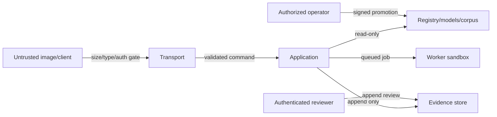

# Security, Privacy and Threat Model

## Protected assets

Source images and collection metadata; corpus and media rights; truth and review
records; model/template/policy artifacts; evidence and inventory integrity;
operator credentials; compute availability; and release provenance.

## Trust boundaries

## Threat/control register

| Threat | Control | Verification |
|---|---|---|
| path traversal/symlink escape | generated object names, canonical path guard, separate roots | traversal and symlink tests |
| decompression bomb/malformed image | request limit, decoder limits, pixel cap, sandboxed worker | malicious corpus fixtures |
| CPU/GPU/memory exhaustion | quotas, bounded rounds/candidates, timeouts, queue backpressure | load and denial tests |
| unauthorized API/review access | authenticated identities, scoped roles, default loopback/no public exposure | authz matrix tests |
| corpus/truth poisoning | pinned digests, source signatures where available, review/quarantine, two-person promotion | tamper and provenance tests |
| model/template supply-chain compromise | offline default, digest allowlist, SBOM, signed artifacts, vulnerability scan | provenance verification |
| evidence tampering/rollback | append-only objects, hash manifests, audit log, protected backups | tamper/recovery drill |
| sensitive data in logs/errors | structured allowlist logging, redaction, opaque client errors | log inspection tests |
| media-license violation | explicit rights state and deny-by-default use policy | rights-policy fixtures |
| network exfiltration | no runtime egress by default; explicit acquisition job only | container/network policy test |
| malicious spreadsheet/CSV output | formula-prefix escaping and safe content disposition | export injection tests |
| dependency vulnerability | pinned lock, SBOM, automated scanning and triage SLA | CI security evidence |

## Current adapter security posture

The Compose API binds to `127.0.0.1`, runs as UID 10001, drops Linux
capabilities, denies privilege escalation, uses a read-only root filesystem and
prevents implicit OCR model download. It has no authentication and is therefore
**not approved for public or shared-network exposure**. The synchronous endpoint
is vulnerable to compute occupancy by expensive valid requests; production
requires the durable queue and quotas in WP-043.

## Privacy and retention

Default processing is local. Images may reveal owner context through
backgrounds or metadata, so EXIF handling, minimization and retention are
explicit policy decisions. Proposed defaults pending owner approval: retain
source/evidence for reproducibility in controlled storage; remove unneeded HTTP
temporary copies only after they are content-addressed; encrypt backups; record
legal/rights holds; never train on user images without separate consent and
truth governance.

## Security release gate

No open critical/high vulnerability, threat-control evidence complete, secrets
scan clean, container provenance verified, dependency exceptions time-bounded,
and an accountable security owner signs the exact release digest.
