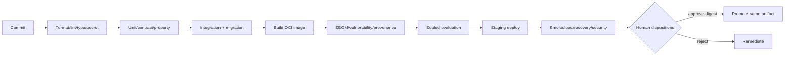

# CI/CD, Release and Environment Plan

## Environment model

| Environment | Data | Network | Purpose | Promotion authority |
|---|---|---|---|---|
| local | synthetic/authorized local | deny by default | development and replay | developer |
| CI | synthetic + licensed test subset | acquisition jobs only | deterministic verification | pipeline policy |
| test | sealed non-production benchmark | restricted | integration/evaluation | QA owner |
| staging | production-like, approved data | restricted | release rehearsal/load/recovery | release coordinator |
| production | explicitly authorized | least privilege | controlled operation | release authority |

Lifecycle labels and branches are orthogonal. A passing `main` build does not
make the application Alpha, Beta or production-ready.

## Required pipeline

Pull-request checks: diff scope, license/secret scan, lock consistency, schema
compatibility, registry validation, unit/property tests, minimum integration
subset, docs/manifest consistency and architecture dependency rules. Protected
promotion adds full benchmark, migration, container scan, SBOM/signature,
staging smoke/load/failure injection, backup restore and release notes.

## Artifact policy

Build once. Promote the exact image digest and immutable corpus/template/model/
policy manifest. Generate an SBOM and provenance attestation. Tagging or
rebuilding is not promotion. Dependencies are exact-pinned and updated through
reviewed pull requests with compatibility evidence.

## Release record

Each release record includes scope/nonclaims, lifecycle label, Git commit,
image digest/signature, SBOM, dependency manifest, schemas/migrations, corpus/
template/model/policy versions, evaluation and operational evidence, known
risks, rollback target, participating roles and explicit approvals.

## Rollback

Rollback selects the prior signed application and compatible read model. New
immutable evidence remains; projections may be recomputed. If a schema is not
backward compatible, use the rehearsed forward-fix or dual-reader plan. Rollback
authority and incident communication are recorded.

## Current branch/release status

`feature/pre-alpha-1-vertical-slice` contains experimental work. Local commits
are evidence of authorship, not remote publication or release. Publication and
lifecycle promotion remain separate authorized actions.
